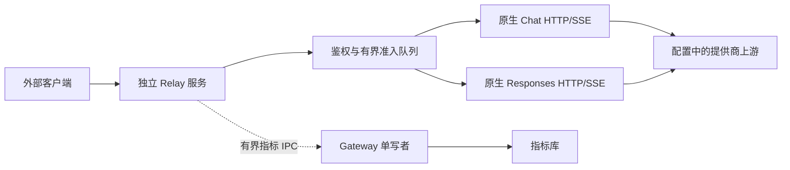

# Provider 模型 API 转发设计与边界

本文记录当前 Model Relay 的实现合同与验收边界。操作命令和配置示例以
[用户指南](user-guide.md#可选模型-api-转发)为准；文件职责以各模块 README 为准。
首版仅 CLP/Chat、三级限流、独立采集开关和旧管理页方案已被替代，不再作为执行计划保留；
逐批实施与故障修复记录可通过本文件的 Git 历史追溯。

## 当前范围

Relay 是独立可选服务，提供原生 Chat Completions、Responses 的 HTTP JSON/SSE 与受限模型列表。
客户端使用独立 Relay Key；上游账户和模型由已验证的配置绑定，不由请求正文或请求头选择。
不连接 App Server，不创建 Thread、Turn、审批、工作区或渠道消息，不执行客户端工具。

| 提供商 | 原生协议 | 材料来源 |
| --- | --- | --- |
| CLP | Chat | 共享受管账户的 API Key、模型目录与请求快照；模型授权由 Key 保存 |
| DeepSeek | Chat / Responses | 受管账户的独立 API Key 与模型目录 |
| OpenCode Go、CCG | Responses | 受管账户的独立 API Key 与模型目录 |
| 自定义主/切换提供商 | Responses | 已注册配置、可独立读取的 API Key 与有效模型目录 |

官方 Codex OAuth 登录态尚未接入 Relay。[只读 Codex 登录转发](relay-codex-auth-development.md)
是独立设计稿，不能把其中的 Provider ID、WSS 传输或模型缓存读取当成现有能力。

默认禁用、回环监听，可显式选择 IPv4 局域网地址或 `0.0.0.0`；后者监听所有 IPv4 网卡，
不保证仅内网可达。跨不可信网络使用用户管理的加密隧道。入口不开放 App Server 或管理 IPC。
Relay 与 Gateway 同机部署，通过私有 IPC 提交指标；多进程仍共享宿主资源及上游账户额度。

## 架构与所有权

| 模块 | 职责与边界 |
| --- | --- |
| [model-relay](../src/model-relay/README.md) | HTTP 入口、Key 鉴权、模型授权、全局准入、队列、撤销和单次指标结算 |
| [model-api](../src/model-api/README.md) | 请求形状、思考策略和协议观察；不读取配置、访问网络或执行工具 |
| [provider-proxy](../src/provider-proxy/README.md) | 共用 HTTP 生命周期、响应头/JSON 校验、背压、取消、协议交付及转储 |
| [runtime](../runtime/README.md) | 提供商材料、网络选择、配置发布、revision 复核、私有 IPC 和服务生命周期 |
| [observability](../src/observability/README.md) | 指标持久化与查询；Gateway 是唯一写入者 |
| [scripts](../scripts/README.md)、[WebUI](../webui/README.md) | 共用管理事务、命令、页面与受控服务操作 |

Chat 与 Responses 共用鉴权、队列、传输和指标基础能力，各自保留终态语义；不做协议互转、
自动协议探测、账户轮换或上游重试。Gateway 重启不停止 Relay 模型请求，但指标接收中断可能丢样本；
Relay 重启取消自身在途请求，不停止共享 App Server。

## 请求与交付链路

1. 限制连接、路径、方法、请求头与读取期限，校验单一 Bearer Key。
2. 原子预占有界上传/等待名额，捕获调用方、Key、代次、提供商、模型权限和取消信号。
3. 有界读取并验证正文，加入等待队列。
4. 按同 Key FIFO、跨 Key 轮转取得全局执行许可及可选速率令牌；上传未结束的 Key 不阻塞其他 Key。
5. 通过 Runtime 读取受信上游材料与网络目标；在异步准备后复核授权、revision、模型及取消状态，再按 Key 与模型覆盖策略处理思考字段。
6. 最后一次复核与创建上游连接之间没有异步间隔；只发送一次，不跟随重定向或自动重试。
7. 按原生协议交付 JSON/SSE，分别记录上游模型终态与客户端交付结果。
8. 释放许可并单次生成指标，放入有界发送器；客户端响应不等待指标 IPC 确认。

上传和等待使用独立预算，不占执行并发。执行许可覆盖出站准备、上游请求和客户端交付，
请求失败不返还已消费的速率令牌。取消后迟到的材料或网络结果不得出站或重复结算。

## API 与参数边界

仅开放 `POST /v1/chat/completions`、`POST /v1/responses` 和 `GET /v1/models`。
模型列表返回 Key 授权列表与对应提供商当前目录的交集；不提供响应读取、取消或服务端会话管理端点。

请求保留解析后的普通 JSON 字段和值，由上游判断模型参数、工具、图片与扩展内容。CLP 鉴权与精确模型匹配后读取共用目录的请求快照；Flash 快照固定出站 `providerOptions.gateway.only = ["deepseek"]`，覆盖客户端同名值，保留其他合法字段，畸形容器在出站前拒绝。标准快照不固定路由；未保存快照时仅精确原 Flash ID 使用历史默认。JSON/SSE 一致，不取消限定重试；其他 Provider 不注入。历史云端探测及限制见[CLP 路由记录](cline-pass.md#上游路由限定探测)。
Relay 不下载远程图片，不读取请求里的本机路径。具体本地边界如下：

| 字段或条件 | 当前处理 |
| --- | --- |
| `model` | 完整 `提供商/模型ID` 最多 265 字符，其中提供商最多 64 字符、模型部分最多 200 字符；模型部分非空、无首尾空白或受限控制字符，且通过 Key 授权与提供商目录校验 |
| `stream` | 只能为布尔值；省略时按 `false` 交付 JSON，不强制全部流式 |
| Chat `messages` | 非空对象数组；不设 256 项上限 |
| Chat `n` | 省略、`null` 或 `1`；当前单选择交付不接受其他值 |
| Responses `input` | 字符串或对象数组；缺失/为 null 时须有非空字符串 `instructions` |
| Responses `store` | 省略或布尔值，出站统一为 `false`，不因 `true` 拒绝 |
| Responses `background` | 省略或布尔值；传入时改为 `false`，省略时不补 |
| Responses 历史引用 | 官方 DS 原样透传；其他提供商拒绝非 null 的 `previous_response_id`、`conversation` |
| 正文预算 | 入站及处理后的请求受 1 MiB 上限约束；输入项不另设 256 条上限 |

DS 历史引用由上游按其无状态合同忽略，客户端仍须携带完整上下文；其他提供商的引用可能
读取共享账户历史，而 Relay 尚无响应/会话归属校验。提供商分支只来自鉴权绑定。
资料见 [DeepSeek 接入边界](deepseek.md#responses-兼容性边界)与
[官方 Responses 参数说明](https://api-docs.deepseek.com/guides/responses_api/)。

思考设置在创建或编辑 Key 时按所选模型分别保存；同一模型在不同 Key 下互不影响。默认“跟随客户端”保留原参数。选择等级时，Responses 使用 `reasoning.effort`，Chat 使用 `reasoning_effort`；CLP Flash 沿用 `reasoning.effort`。显式等级或关闭方式覆盖顶层思考控制字段；上游不支持时可以拒绝，Relay 不自动换参数重试。

“关闭”展开以下显式字段方式；`off` 仅保留为既有配置与 CLI 的自动映射值，不再出现在 WebUI 新选择菜单中。选项只指定出站字段，不保证模型停止内部推理或零推理 Token：

| 配置值 | 出站控制 |
| --- | --- |
| `off` | 原有默认映射：受支持 DS Responses 和 CLP Flash Chat 为 `reasoning.effort=none`，DS Chat 为 `reasoning_effort=none`，其他明确支持的 CLP Chat 为 `reasoning.enabled=false`；未声明能力的组合保留客户端参数 |
| `off-reasoning-effort` | `reasoning: { effort: "none" }` |
| `off-reasoning-enabled` | `reasoning: { enabled: false }` |
| `off-reasoning-enabled-thinking` | `reasoning: { enabled: false }, thinking: { type: "disabled" }`，对照 Cline DeepSeek 的组合关闭字段 |
| `off-reasoning-effort-field` | `reasoning_effort: "none"` |
| `off-thinking` | `thinking: { type: "disabled" }` |
| `off-enable-thinking` | `enable_thinking: false` |
| `off-chat-template-thinking` | `chat_template_kwargs: { enable_thinking: false }` |
| `off-google-thinking-budget` | `extra_body: { google: { thinking_config: { thinking_budget: 0 } } }` |

新增嵌套方式分别参考 [Qwen vLLM](https://qwen.readthedocs.io/zh-cn/stable/deployment/vllm.html) 和 [Gemini OpenAI 兼容接口](https://ai.google.dev/gemini-api/docs/openai)。Gemini 零预算仅适用于允许关闭思考的型号；这些字段不保证任何 Chat/Responses 中间服务支持。强制策略会移除其他已知思考控制，包括模板中的 `enable_thinking` 和 Google 的 `thinking_config`，保留其他模板及 Google 参数；结构不合法或 SDK 包装层中的冲突字段明确拒绝。

DS 原生 Responses 的自动 `off` 同样清除客户端 `reasoning.enabled`，避免与强制写入的 `effort=none` 冲突；保留 `summary` 等非开关选项。

旧六项或八项浏览器记录不符合当前九项结果合同，读取时显示缓存不可用且不覆盖原始数据；用户可手动清除检测历史后重新检测。升级不迁移或删除缓存，不更改已保存的 Key 策略；回退代码可继续读取未清除的旧记录。新增策略保存仍使用现有配置预览、确认和备份流程；回退到不支持新策略的版本前应先改回原有策略。

显式字段方式适用于受管和自定义 Relay 提供商，不按模型名称推断其有效性。2026-10-15 的 CLP Flash 受限实测中，`enabled=false` 未返回思考正文，但仍报告非零推理 Token，详见 [CLP 当前限制](cline-pass.md)。
WebUI 的 `POST /api/v1/management/relay/reasoning-probe` 接受配置 revision、精确公开模型 ID 和原生协议，不接受调用地址或凭据。用户手动开始后，按固定顺序比较无控制基线及八种显式关闭方式，共最多 9 次请求、每次请求 64 个输出 Token；不自动重试，不写服务器配置或历史。复用 Relay 的模型材料、参数投影、CLP 路由限定、代理选择和直接 Chat/Responses 解析；请求前及出站前复核版本，材料变化时停止。每个 WebUI 实例最多执行一组，单请求限时 15 秒、总预算 135 秒，成功响应最多 128 KiB（含 SSE 注释等原始正文），错误正文沿用 64 KiB 上限。断连、取消和超时释放网络资源。以 `application/x-ndjson` 推送 `progress`、最终 `result` 或受控 `error` 事件；每项开始与结束均推送当前方式及九行快照，`observedAtMs` 记录整组开始时间。前端限制单行 64 KiB、整流 256 KiB，140 秒预算覆盖完整响应读取；缺少最终结果的断流不能当作完成。返回逐项结构化状态、HTTP 状态及有限用量观察，不返回正文、凭据或任意上游错误；缺失推理用量保持未知，结果不判定内部推理是否关闭。采用结果只回填模型草稿，保存仍走既有预览确认。

浏览器使用独立版本化 localStorage 缓存九项全部执行、`stoppedReason=null` 的最终结果，每个公开模型 ID 与协议保留最近一组，最多 20 组、7 天；缓存与 Key 无关，但采用必须匹配当前配置 revision。读取时校验版本、结构和容量，损坏或不支持的版本不静默覆盖；存储失败显示提示并保留本次内存结果。记录只含受限观察元数据，无凭据或正文，支持显式清除；取消、断流或整组提前停止的结果不覆盖已有完整记录。该缓存可丢弃，无需迁移或服务器数据备份，回滚代码不会改变 Gateway 配置或数据库；重新探测始终需要用户手动发起。
`extra_body` / `extraBody` 内的思考控制字段与关闭策略冲突时返回具体字段路径；
跟随客户端不增加该限制。不修改历史思考内容或隐藏上游输出。

普通端到端请求头透传；连接级头、客户端凭据、代理身份和 Codex/Relay 私有路由字段过滤，
由出站模块重建鉴权与传输头。响应头受白名单限制。诊断转储的脱敏规则不改变实际出站头。

两协议共享 HTTP 状态、Content-Type 和 JSON 解码检查，非法 JSON 返回
`invalid_upstream_json`。上游错误仅暴露受控分类，不返回未经约束的错误正文。
Chat 保留原始扩展字段与工具增量；流式结束后允许附带用量、重复相同结束原因且 delta 仅含空 content / assistant role 的统计尾帧，仍须收到 `[DONE]`。结束后追加内容、工具或不同结束原因仍拒绝；Responses 保留原生事件和 completed/failed/incomplete 终态。
终态前断流不得伪造成功；SSE 开始后用对应协议的失败事件结束，可写性丢失时只关闭并记录。
客户端应在有效终态后执行工具，上游完成不等于客户端已收到全部输出。

## CLP 转发模型目录与设置

CLP 与 CCG、OCG、DS 一样从受管提供商的共用模型目录提供 Relay 材料，不再下载独立 Cline 模型文件。模型管理中的“按 ID 添加”提供独立填写及继承已有模型，固定 DS 模型走内置映射。CLI、WebUI、渠道和 Relay 读取同一份保存结果；提供商行的“模型列表”只读展示调用 ID、输入格式和协议。

`GET /v1/models` 只返回当前目录与该 Key 授权的交集。每把 Key 的 `models` 保存 1–256 个唯一的 `提供商ID/模型ID`，可跨提供商；新增目录模型不会自动授权。CLP 对外只去掉 `cline-pass/`，出站必须通过当前目录精确匹配还原 ID；其他提供商保留完整上游模型部分。映射重名拒绝调用，无别名、自动回退或协议转换。

Relay 复用受管账户的私有凭据及目录材料读取、修订校验和恢复保护；不连接 App Server，不执行 Codex 工具流程。CLP 仍只提供原生 Chat 协议，客户端参数由上游判断；Key 的思考策略独立于渠道模型默认值。CLP 明确保存的请求快照也用于 Relay：Flash 快照使用 Flash 思考映射并发出 DeepSeek 路由限定，标准快照保留标准行为。没有请求快照的旧条目仅保留精确原 Flash ID 的历史默认映射。

目录材料变化会撤销该提供商旧在途请求，移除模型会限制后续 Relay 调用；Key 授权、逐模型思考策略及历史统计不自动改写。重新加入相同 ID 可能恢复旧授权，永久撤销应在 Key 管理中操作。目录缺失、损坏或存在未完成事务时相应提供商不可用，不回退到旧独立目录，其他提供商仍按自身材料处理。

旧 `cline-relay-models.json` 和其备份不再读取、修改或自动删除。部署前应核对仅存在于旧 Relay 目录中的模型，明确按 ID 加入受管目录；保留 Key 授权原值。目录修改继续使用现有备份、版本校验及事务恢复。回退旧版本前保留当前数据并核对该版本所需目录；旧独立 Relay 文件仍可供旧程序使用，不能用旧目录覆盖后续受管模型修改。

管理预览绑定配置和目录修订，候选或目录变化后须重新预览。Relay Key 的 WebUI 预览和确认接口正文上限仍为 512 KiB，配置文件上限仍为 1 MiB。目录不可用时，保留原模型授权的改名仍可保存；改变授权须通过当前目录校验。服务、CLI 查询和页面打开都不再自动下载 Cline 目录。

输入标签来自受管目录的显式 `input_modalities`；未声明时显示未知，不从模型名称猜测。标签不扩展 Relay 的请求协议，也不自动启用 Cline 搜索工具。关闭思考能力来自保存的模型等级；显式参数策略仍由 Key 单独选择，目录声明不证明上游接受所有参数。

已有 Key 的 `reasoning=passthrough|off` 保持原义，不自动迁移；未设置逐模型覆盖的模型继续使用该值。WebUI 显式保存完整模型映射后才清除旧统一值。CLI 可用 `--model-reasoning '{"提供商/模型ID":"high"}'` 提交完整映射，不能同时提供 `--reasoning`；显式使用原 `--reasoning` 会清除模型映射并恢复 Key 统一策略。回退到不支持模型映射的程序前，先用当前 CLI 明确设置旧统一策略或恢复保存前的配置备份，再回退程序；不同模型的独立策略不能由旧版本完整表达。新字段不是自动迁移机制，旧程序遇到未知字段应拒绝，不能静默忽略。

## 身份、材料与资源

配置来自 Gateway TOML 的 `[model_relay]`。每个调用方对应一个 Key，可显式授权多个提供商的模型；
每把 Key 的模型集合、策略、凭据与代次独立。轮换后旧秘密失效，禁用、改绑、删除及材料变更
取消相关上传、等待和在途租约。模型目录与凭据始终由现有提供商模块解析，不复制账户管理。

CLI/WebUI 共用预览、确认、配置锁、revision、私有备份与原子保存。完整新 Key 只显示一次，
失败或响应丢失不能通过自动重复签发恢复。保存与运行态应用分别报告，不自动启动服务。

仅保留全局并发及分钟速率限制，账户和 Key 不另设限流层。`requests_per_minute=0` 只关闭速率限制，
不关闭并发和队列预算。上传/等待最多 32 项、正文总预算 16 MiB，正文验证后最多等待 30 秒。
队列只在内存中，重启不重放；这些限制不能提供 Token、费用或套餐硬预算。

删除或改绑保留最小历史身份摘要，用于旧调用指标结算及禁止身份复活；不保存正文或旧秘密。
摘要最多 4096 项并受配置大小约束，耗尽时拒绝整次操作。不删除提供商本身的配置或凭据。

## 指标、转储与管理诊断

每次实际出站只生成一个模型请求样本，保留真实提供商、调用方、Key、凭据代次与请求 UUID；
Thread/Turn 为空，不伪造成 Codex 会话。指标发送有界且不重试；`accepted` 仅表示接收确认，
不等于落盘，`unconfirmed` 也不能直接当作丢失。指标不能充当可靠账本。

Relay 与 Codex 共用全局 debug 转储开关与 production/debug 模式。V2 转储使用
`relay.chat` / `relay.responses` 标签，共用容量与待写预算；生产与调试模式均脱敏必要凭据，
保留普通头及关联信息。调试模式可对照入站、出站和实际交付；实际补入或覆盖 CLP 路由时记录 `provider_routing_pinned`，读取器和中英文 WebUI 同步识别，已符合限定时不误报；非法、截断、未采集与未交付分别显示。
普通头可能包含业务数据，不承诺识别任意自定义编码秘密。详细采集口径见
[WebUI 调用详情](webui.md)和[代理模块](../src/provider-proxy/README.md)。

运行状态区分已配置并发与运行快照，明确显示等待、准备、上游处理和交付，以及指标确认和采集状态。
私有控制 IPC v6 提供最多 64 行的当前请求快照，必需的可空 `reasoningEffort` 只展示已验证入站请求的等级；拒绝旧版本及旧行结构，更新后须重启 Relay 和 WebUI。WebUI 请求队列页面通过 SSE 变化通知触发有界快照读取，
隐藏或关闭时取消订阅，失败不显示伪造零值。页面服务管理沿用现有预览/确认任务。

## 当前数据格式与失败恢复

### 原生双协议与提供商公共接入

当前 Relay 配置不保存 `accounts` 或调用方 `provider` 字段，授权只来自 `callers[].models`。旧字段、升级及回退命令明确拒绝，不自动转换。提供商 ID 为 1–64 位 ASCII 字母、数字、下划线、连字符，模型部分最多 200 字符；保存与出站均核对实际目录。事务备份用于恢复失败，不得恢复已撤销的凭据。

指标库只接受 Schema v35，保留 Relay 三元组完整性、真实调用方、空 Thread/Turn 和请求 UUID 去重约束。原始上游接收点采集请求正文大小、响应时间与生成区间，经受校验 IPC 入库，不依赖转储。新安装直接创建当前结构，不在启动时迁移；保留 v31/v32/v33/v34 历史需通过显式更新或仓库中的离线升级工具。图片操作类型供原生代理采集使用，不扩展 Relay 的模型 API 路由。

服务公开目标仅接受 `relay`，内部服务名及 `service-model-relay` 入口保持不变。配置与采集只接受当前格式。

## 验证范围与剩余限制

后续修改按[开发流程](development-rules.md#development-workflow)核对受影响的请求、交付和指标链路；
静态门禁及证据复用遵循[验证规则](development-rules.md#verification)。以下为限于明确基线的历史
观察，不构成当前全部合同的验收声明。

2026-09-29 部署后只读核查已确认 DS Responses SSE/JSON、CLP Chat SSE/JSON 的既有成功调用，
实际指标库为 v23，提供商、状态、用量与转储可关联，Thread/Turn 为空。此证据限于当时部署与样本，
不代表后续提交均已部署，也不替代真实 failed/incomplete、撤销、过载、关闭竞态、局域网设备、
防火墙及多平台实机验收。
