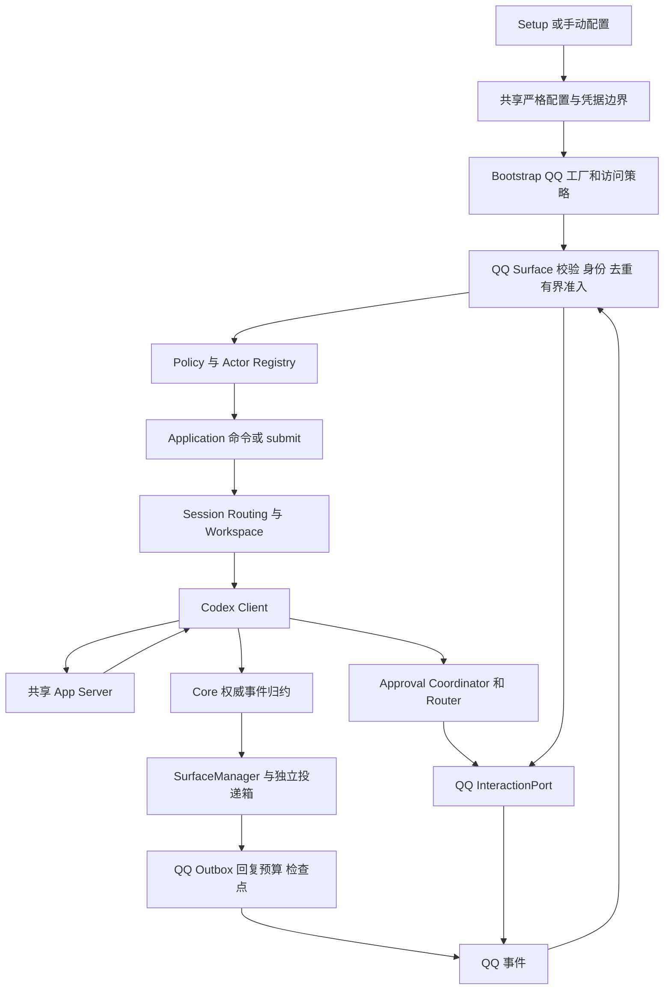

# QQ Surface 接入设计与全链路审查

## 状态与范围

本方案包含设计及正在实施的首个文本切片，尚未通过真实 QQ 账号验收。初始分析基于项目提交 `67a2735afb18f1e786d073ad9dfc8c7d49b8020c`，
资料核对日期为 2026-10-23。用户随后授权开始实施；当前不新增项目依赖、不启用真实账号、不发送平台消息、不部署。
官方资料和 SDK 的能力声明不等于目标账号可用；开放事项及完成门槛见本文末尾。

当前切片采用手工凭据与 WebSocket 窄协议，统一配置、Setup、Doctor、Policy、会话命令和可靠输出；
SDK 继续作为锁定源码参考，不引入需要大幅替换实现的运行依赖。实现边界见 [QQ 模块合同](../src/surfaces/qq/README.md)。
提交关联以实际 submit 响应为准；提前到达的输出仅有界等待提交关联，失败保留未确认，不推测归属。
首片重启后隔离旧 ReplyGrant，不承诺自动恢复旧被动回复。审批暂用安全拒绝；扫码、Webhook、
完整交互、更多命令、图片、流式与新回复依据的显式恢复仍待后续切片，不把初版配置字段等同于下面全部候选设计。

建议首个完整交付范围为单 AppID、允许名单内的 QQ 单聊：文本输入、已有会话命令、安全交互、最终结果与可靠投递。
流式正文与图片作为同一设计中的增强切片；未完成的切片必须明确不支持。群聊、频道、多账号、语音/视频、
定时主动推送不进入首版。群聊需要重新决定共享 Thread、成员授权和全群可见的输出边界，不能仅增加事件名。

继续遵守[渠道接入指南](surface-integration-guide.md)、[可靠投递合同](delivery.md)和[协议能力索引](index.md)。
不引入 OpenClaw/DSH 宿主，不让 QQ 管理第二套 Thread、Turn、历史或审批状态；不修改 Codex 协议。

## 官方资料与 SDK 分工

本地副本及固定提交记录在[上游资料索引](upstream-sources.md#qq-接入研究基线)。资料保留在 `upstream/`，
不进入发布包、不作为直接源码依赖、不自动更新。新官方实现与旧官方 SDK 分开评估。

| 来源 | 已确认职责 | 本方案采用方式 |
| --- | --- | --- |
| `tencent-connect/qqbot-nodejs` 1.0.5 | 新协议 SDK；QQBot 高层门面、公开 `/protocol` 入口、WebSocket/Webhook、消息/媒体/单聊流式 | 主要协议实现参考与候选依赖；按公开能力逐项审查，不直接采用全部默认行为 |
| `@tencent-connect/qqbot-connector` 1.2.0 | 扫码获取 AppID、AppSecret，可返回扫码用户 OpenID | 仅为 Setup 的可选扫码入口；不是收发 SDK，不能代替运行时传输 |
| `tencent-connect/openclaw-qqbot` 2.0.4 | 使用上述两个 SDK 的 OpenClaw 渠道插件 | 参考装配、双传输与回复策略，不引入宿主、历史和 Agent 编排 |
| `tencent-connect/dsh-qqbot` 0.5.2 | 使用上述两个 SDK 的 DSH 插件 | 参考绑定、审批、问题和流式适配，不引入 Cordis/DSH 状态 |
| `tencent-connect/bot-node-sdk` | 旧频道 SDK，`v1` API 与 `Bot AppID.Token` 鉴权 | 不作为新渠道运行依赖 |
| `tencent-connect/botgo`、`bot-docs` | 旧官方实现与文档源码 | 验签/历史语义对照；不能覆盖较新的线上文档与新 SDK |

腾讯组织入口为 [tencent-connect](https://github.com/tencent-connect)。新版 SDK 的存在纠正了“官方只有旧 Node SDK”的判断。
默认不采用旧 SDK，也不因新 SDK 功能齐全就放弃本项目的取消、授权和持久投递合同。

### SDK 的实际适配边界

以下是固定源码观察，不是运行测试结论：

| 边界 | 固定源码证据 | 设计影响 |
| --- | --- | --- |
| HTTP | `qqbot-nodejs/src/protocol/api/api-client.ts` 的 `RequestOptions` 没有外部 signal/fetch 注入；`fetch` 返回后清除超时，再读 `res.text()` | 外层 `Promise.race` 不能取消底层传输，也不能约束正文；不能直接作为可靠写入客户端 |
| HTTP 成功 | 同文件主要按 HTTP 状态解析，成功体直接 JSON 返回 | 各方法必须另外校验业务码和必需字段，尤其 Token 的 HTTP 200 错误、异步审核响应 |
| 日志 | HTTP debug 会输出正文；错误包含原始服务端信息 | 不将 SDK logger 直通项目 Logger；仅输出本地分类和限长 TraceID |
| Webhook | `protocol/transport/webhook.ts` 对 Dispatch 启动后台处理后立即返回成功 ACK；验证挑战另走分支 | 需要本项目负责有界接收与 ACK 决策，不能用默认 ACK 表示已经安全接收 |
| 序号 | `protocol/api/routes.ts` 的 `getNextMsgSeq` 是随机/时间组合 | 项目必须自己拥有账号、消息和发送操作关联的序号分配及恢复，不拿随机序号冒充幂等性 |
| 生命周期 | `GatewayConnection.start()` 是运行期 Promise，实例为单次使用；配置可限定重连 | 适配为 Surface 启动就绪与后台运行两阶段；不能直接 `await start()` 当作启动完成 |
| 中间件 | SDK 提供 history、引用索引、授权、命令、格式化等可选能力 | 不启用重复业务状态和宽松授权；本项目复用 Policy/Application/Approval/InputBatcher |

公开 `/protocol` 已核对导出 routes、codec、`dispatchEvent`、`GatewayConnection`、Webhook 验签/挑战签名工具。
`dispatchEvent` 使用类型断言，不替代本项目的外部数据校验。`MessageApi.sendRaw` 可显式提供 msg_seq，
`sendC2CStreamMessage` 可传完整分片参数；但构造器依赖有 private 状态的具体 `ApiClient/TokenManager`，不是可注入的窄 RequestPort。
可评估通过公开子类覆写 request/token 方法连接受控执行器；这是尚未编译验证的候选，且每次发送仍无 signal 参数，
不得用共享可变 signal 连接并发请求。分片媒体另走内部 HTTPS，不被这种桥覆盖。

`GatewayConnection` 直接创建 WebSocket，没有公开 agent/factory；Token/URL 回调不能解决 WebSocket 代理。
其 seq 在业务回调前保存，异步回调失败只记日志，onRawEvent 也不包含完整 envelope；不能把 session 持久化视为输入已提交。
内置 Webhook callbacks 没有 raw 事件入口；只替换 server adapter 也不能补齐生命周期事件分发。
因此默认 Transport 只能在 G1/G2 证明接收、代理和取消合同后采用，不能默认视为可复用完成。
`StreamSession.complete()` 在末片请求前标记完成，失败后再调用会直接返回；cancel 只清计时器，
不取消在途发送与退避。可靠流式不采用该高层状态机，需由本项目顺序器掌握最终确认。

候选方案是优先复用上述公开协议原语，平台 HTTP、回复预算、检查点由窄 Adapter 负责。
实施前必须证明选中的运行能力能通过公开接口满足合同；若需要改 SDK 私有字段、全局 monkey patch、
导入内部文件或替换大部分实现，则不引入该依赖，保留固定源码参考并实现实际需要的窄协议。
不能为了“用了 SDK”引入仅供类型引用的运行依赖。具体可采用范围属于门槛 G1。

### DSH 与 OpenClaw 关联参考结论

已按固定提交追踪两个插件的 Setup、入站身份、审批、流式终态及回复额度调用链；以下均为源码判断，未运行复现。

| 参考路径 | 可以借鉴 | 不可照搬的触发与影响 |
| --- | --- | --- |
| DSH `src/setup/binding-service.ts`、`setup/persist.ts`、`src/index.ts` | 扫码状态、呈现、保存分离，刷新代次保护二维码显示 | 成功回调未核对刷新代次并只取数组第一项；保存失败仍可用内存凭据启动；错误指导可能输出 Secret。项目必须在实际提交边界复核且不泄密 |
| OpenClaw `src/setup/login.ts`、`setup/finalize.ts` | start/wait 分离，按账号管理扫码流程 | 旧 waiter 在 await 后删除同 key 当前会话；扫码用户自动加允许名单。项目要核对精确会话代次并由本地明确授权 |
| DSH `src/gateway/middleware-setup.ts`；OpenClaw `src/middleware/access-control.ts`、`gateway/event-handlers.ts` | 平台 sender 与 conversation 分开传递 | 空名单放行/转为通配符、审批 Actor 多字段 fallback。QQ 接入必须空名单拒绝，字段只认当前合同 |
| DSH `src/features/approval-channel.ts`、`button-utils.ts` | 有限决策与会话取消 | 按钮只有 allow/deny，没有请求随机 token；按当前会话 pending 路由，旧按钮可能作用于新请求；发送后才登记 pending。不得复制 |
| OpenClaw `src/features/approval-handler.ts` | 跨客户端 resolved 与账号注册 | 可批准的命令被截断，通用 always、发送后登记与计时；无 pending 也可发审批 RPC。必须改用本项目完整预览和 Router 合同 |
| DSH `src/transport/outbound.ts`、`streaming-writer.ts` | 串行节流 | 有 buffer 时忽略 durable 最终 content；部分成功后末片失败不触发完整结果保障，flush 后还清 buffer。不能据此确认最终回答 |
| OpenClaw `src/outbound/streaming-controller.ts` | 流归属与串行调度 | finalize 使用 lastAcceptedFull 而非权威最终内容，前缀修订会拼接旧文；末片失败可进入 done。项目不得修改答案语义来迁就流式 |
| 两插件 reply limiter 与 sender | 平台回复预算集中管理 | 过期删除记录后同 ID 可变成新额度，计时始于首次发送；超限自动去掉 msgId 转主动，DSH 还能借最新消息锚点。项目必须保守占额和精确归属 |
| OpenClaw `src/gateway/lifecycle.ts`；DSH `src/gateway/bootstrap.ts` | 资源集中归属、ready/disconnected 事件 | ready/resume 重建交互、断线仅日志不足以证明旧审批已撤销；QQ 恢复与 App Server 订阅恢复必须分开 |

不借鉴两个宿主的 session manager、history buffer、引用正文索引、JSONL 历史、全局自动批准命令或宽松输入门禁。
SDK 与两个插件均不是本项目完整性、授权或平台投递成功的证据。

### 当前官方合同与冲突

| 主题 | 当前资料 | 处理原则 |
| --- | --- | --- |
| 鉴权 | [访问凭证](https://bot.q.qq.com/wiki/develop/api-v2/dev-prepare/access-token.html)：AppID/AppSecret 换取 Access Token，`QQBot` 鉴权 | 固定当前官方域名；Token 内存缓存与合并刷新；不兼容旧 Bot Token |
| 传输 | [WebSocket](https://bot.q.qq.com/wiki/develop/api-v2/dev-prepare/event-emit/websocket.html)、[Webhook](https://bot.q.qq.com/wiki/develop/api-v2/dev-prepare/event-emit/webhook.html) 均有当前文档，新官方 SDK/插件也支持双传输；旧 BotGo 有下线说明 | 不再依据旧说明断言 WebSocket 不可用；首选评估无需公网的 WebSocket，目标账号实测后锁定；Webhook 为明确配置的替代方式，不自动切换 |
| 被动回复 | [概述](https://bot.q.qq.com/wiki/develop/api-v2/server-inter/message/overview.html)列单聊 60 分钟/4 次，群聊 5 分钟/5 次；[单聊发送页](https://bot.q.qq.com/wiki/develop/api-v2/autogen/api/v2_users_user_openid_messages.post.html)的 `msg_id` 字段却写 5 分钟 | 在确认前采用不超过 5 分钟的本地保守发送窗口；60 分钟不是交付保证；额度按消息来源计数 |
| 主动发送 | 当前概述描述主动消息和召回，用户可关闭接收 | 首版不自动从被动切换为主动/召回；SDK/插件的 fallback 不构成本项目授权 |
| Markdown | [格式页](https://bot.q.qq.com/wiki/develop/api-v2/server-inter/message/type/markdown.html)写明 2026-04-23 单聊/群聊自定义 Markdown 开放 | 不再把模板申请作为单聊通用前提；仍实测代码、链接和长度限制 |
| 按钮 | [按钮页](https://bot.q.qq.com/wiki/develop/api-v2/server-inter/message/trans/msg-btn.html)仍有模板申请/自定义按钮内邀描述 | 与 Markdown 权限分开；首版不能依赖所有账号都有自定义按钮 |
| 流式 | [流式接口](https://bot.q.qq.com/wiki/develop/api-v2/autogen/api/v2_users_user_openid_stream_messages.post.html)要求顺序分片，已下发前缀不可改 | 只流式追加正文，不把“处理中”替换为无共同前缀的最终回答；末片单独确认 |

这些冲突通过具体账号、SDK/文档版本和实际响应收敛；不使用放宽默认值或隐式别名掩盖。
Token 页还存在 `expires_in` 类型表为 number、示例为数字字符串的差异，解码允许范围必须在 G1 核定并显式列出，不使用通用宽松转换。

## 全链路与现有落点

| 路径 | 已核对入口/消费方 | QQ 关联调整 |
| --- | --- | --- |
| 配置读取与启用 | `runtime/gateway-config.mjs`、`src/config/index.ts` | QQ 严格结构、至少一个渠道启用条件、账号身份、URL/端口与凭据检查 |
| Setup 与管理读面 | `scripts/setup.mjs`、`scripts/config-summary.mjs`、`scripts/config-management.mjs`、`webui/src/pages/channels-page.tsx` | CLI 配置与 WebUI 状态同源；WebUI 当前渠道页主要显示状态和 CLI 引导，不凭空增加凭据编辑页面 |
| 装配 | `src/bootstrap/surface-composition.ts`、`surface-plugin.ts` | 显式内置插件，单实例 `qq + AppID`，不扫描插件目录 |
| 共享授权 | `gateway-component-graph.ts` 的 `accessPolicy`、命令守卫、`outputOwner/outputAuthorized` | 必须增加 QQ 策略分支；只注册 Adapter 会导致命令/恢复投递失败关闭 |
| 输入到 Turn | `src/application/conversation-service.ts` 的 `submit`、`submitInputLocked`、`startNewTurn` | 实时授权闭包贯穿会话锁和最终 RPC；活跃轮次走既有 steer，不自建下一轮输入队列 |
| 绑定和恢复 | `src/session-routing/router.ts`、`src/storage/sqlite-binding-store.ts`、Bootstrap 绑定恢复 | 使用既有前后台绑定；禁用保留、撤权清理与退订；新增渠道字符串本身不要求 Schema 迁移 |
| 输出 | `surface-manager.ts`、`persistent-surface-output.ts`、`surfaces/delivery-policy.ts`、`delivery-receipt.ts` | QQ 策略在统一入口决定；持久正文和瞬时状态分开；实际确认后才结算 |
| 审批 | `src/approval/coordinator.ts`、`interaction-router.ts`、`types.ts` | 复用请求归属、总期限、跨客户端失效；QQ 不复制审批状态机 |
| 图片 | `scripts/channel-send-image.mjs`、`bootstrap/channel-image-spool.ts`、Surface `sendChannelImage` | 显式图片现有入口缺少回复归属，须独立补齐 G3 合同后开放；上传成功不等于发送成功 |
| Hook 与计划任务 | 组合根 Hook 审查能力回调、`scheduled-task-composition.ts`、Surface 确认呈现 | 未证明完整预览的 Hook 写操作拒绝；首版不开放 QQ 定时推送，必须连同 Agent 的 schedule tool 入口门禁，不只隐藏菜单 |

这是相关入口、共享合同与关键实现的审查，不是整个仓库逐文件审计；上游 Codex RPC 语义沿用当前已接入合同，不新增协议能力。

## 输入 身份与接收确认

### 身份与授权

`surface=qq`，`accountId=AppID`，单聊 `conversationId=c2c:<user_openid>`；Actor 取当前事件中经过校验的用户字段。
平台 OpenID 不当作 QQ 号码，不假设群成员 ID 与单聊用户 ID 等价。事件账号来源必须能绑定到本 Adapter：
WebSocket 来自本账号鉴权连接；Webhook 校验原始字节签名，并核对有合同的 AppID 字段。
字段缺失、相互冲突、跨账号、非单聊场景或未知特权类型，拒绝进入 Application。

先授权，再记 Actor、解析可执行命令、下载附件和使用回复凭据。仅收到消息、扫码成功、机器人加好友都不自动加入允许名单。
命令和普通输入都传实时授权闭包；异步等待后检查原 Workspace、目录和 Thread，复用现有提交守卫。
`/stop` 保持授权后的即时取消路径，不等待长附件或普通消息处理排空。

输入聚合使用 `SurfaceInputBatcher`，只合并同账号/会话/Actor 的已授权输入。入站平台消息 ID、事件 ID、
消息分片标识和下行 `msg_seq` 分开建模；不能把下行回复序号当作入站去重身份。
单聊事件文档对 `msg_seq` 与 `message_scene.ext.msg_idx` 有不同描述，最终去重键要以原始事件核对，缺少必要身份不提交。

### 接收与执行的非原子边界

Webhook ACK 仅表示事件接收；App Server 接受输入、Turn 完成、QQ 回答送达是后续独立阶段。
不能等完整模型执行后才 ACK，也不能无容量检查就成功 ACK 后静默丢弃。

设计选择是有界准入加保守防重，不承诺恰好一次：在提交 Application 之前，先原子记录最小接收身份和 `claimed` 状态；
业务执行结果确认后记录 `submitted` 或明确未提交。记录不包含消息正文、附件 URL 或审批内容。
重启看到 `claimed` 时按“可能已提交”隔离，不自动再次执行；要求用户核对 App Server 的会话后重新发起，不能自动制造重试 Turn。
已成功 ACK 但尚未执行时崩溃可能丢失该输入，必须在运维状态中显示未确认接收；不以历史缓存修补，也不声称无损输入。

接收登记的身份、有效期、容量、过期拒绝与平台重试时间必须一起确定：保留窗口内不驱逐已处理身份以重新执行；
容量满时拒绝新的业务准入并使失败可见。持久记录失败前不提交；写入结果未知不补发。
Webhook 正确的失败 ACK/重试合同、WebSocket 重放序列何时推进，以及无正文登记如何向用户解释未确认输入，属于 G2 的上线门槛。
本节为新增平台传输元数据设计，不宣称当前仓库已经有通用入站事务。

### Webhook 专属边界

只在显式选择 Webhook 时启用独立本机回调监听，优先回环地址加由操作者管理的 HTTPS 反向代理。
不自动创建公网隧道、不修改 WebUI 绑定地址、不暴露 App Server。路径、方法、Content-Type、原始正文大小、读取期限、并发数均有界。
签名基于原始字节，不使用 JSON 重编码结果；签名与账号校验在业务解释之前。
挑战请求与普通事件分开；挑战的认证要求、时间戳新鲜度和合法重投策略需对照新版 SDK、官方 Go 实现和真实回调收敛，
不能把默认 SDK 的免验签挑战直接当作安全合同。代理不得重写签名体，不信任任意 Forwarded 头授予权限。

## 凭据与配置生命周期

手工输入的 AppSecret 是静态应用配置，按既有合同保存在私有统一 TOML；自动取得的 Access Token 可再生成，仅驻内存。
扫码 Connector 返回的仍是同类 AppID/AppSecret，不是另一种 OAuth Token；发布类型没有承诺有效期或刷新凭据。
扫码秘密跨重启保存到 QQ 独立安全凭据命名空间，这是本项目的存储策略，不能照搬 README 示例打印 Secret。
两种来源在运行时复用相同的 AppID/AppSecret 验证及 Access Token 获取语义，不套用未被平台定义的 OAuth 生命周期。
手工和扫码是明确二选一的来源，不在读取失败时互相回退；配置只记录来源选择与 AppID，不复制扫码秘密。

候选配置字段为 `enabled`、`app_id`、`credential_source`、手工模式的 `app_secret`、`allowed_user_openids`、
`transport` 及 Webhook 所需的回环端口/路径；这些尚未加入当前 Schema。缺少配置保持禁用；出现未知字段、缺失启用必需信息立即拒绝。
账户与凭据/传输变化重启 QQ 所属 Gateway 生命周期；允许名单可以按现有契约热替换并失效在途交互。
禁用保留绑定和未确认结果，重新启用不自动放宽权限；撤权只影响精确账号和 Actor。

Connector 1.2.0 发布包已核验 npm integrity。其 README、类型及压缩代码表明它用 HTTPS 创建/轮询扫码任务并解密返回秘密，
没有消息收发能力；公开导出仅 `qrConnect/startQrConnect`。发布包标记 `UNLICENSED`、无 repository 字段，
但同组织两个官方插件明确依赖它。采用前核对分发使用条件，不将“能下载”当作可以复制源码。

扫码入口拟采用回调 API 并关闭 SDK 控制台打印，使用 Setup 自己的展示与脱敏结果；二维码 URL、绑定 task ID 和加密 key 不进入持久日志。
SDK 取消不会传递到其每次 HTTPS 请求，且已完成响应可晚于取消触发回调；Setup 必须用代次和总期限拒绝迟到成功，
不能只调用 `stop()` 就认为资源已退出。若公开接口不能满足退出和网络合同，应放入任务拥有的隔离进程并明确限时收尾，
或暂时只支持手工配置；不得全局替换网络函数。扫码返回数组严格限定首版单账号，不能默认取第一项；缺少 OpenID 不自动授权任何用户。

CLI、Setup JSONL、WebUI 状态和 Doctor 只显示凭据配置状态。保存和激活分开报告；确认及提交开始前取消不写入，
账号选择和配置修订变化使预览失效。进入保存后不承诺取消能撤销写入，须等待实际持久化结果结算。
安全凭据后端与 TOML 不是一个原子事务：凭据已保存而配置未提交时，保留可核对的凭据版本和待恢复状态；
配置已提交但返回失败时先读回核对修订及目标，不重复写入；结果未知时保留有关凭据，不盲目覆盖或删除。
并发修订使配置提交失效时，重新生成预览，不能恢复旧快照覆盖其他入口的新配置；补偿只有在能证明仍拥有该凭据版本时才允许。
这些结果需由共享管理逻辑统一报告，具体事务及恢复合同纳入 G6，不能仅依赖扫码回调代次检查。
Doctor 是只读检查，不扫码、不刷新权限、不发送试验消息。Webhook 公网可达性与 QQ 账号真实能力在未观察时显示未知。

## 输出 回复预算与可靠恢复

### 传输客户端

每次 HTTP 操作使用平台窄接口：按当前官方端点构造路径，校验/编码 ID，拒绝非预期跳转，复用 Bootstrap 注入的代理感知 Fetch。
超时覆盖请求、正文读取和响应校验；总取消信号覆盖排队、刷新 Token、退避、上传和发送。每个响应有字节预算。
Token 刷新按账号合并，凭据换代后拒绝旧刷新结果；关闭不再发起刷新，日志不包含请求/响应原文。

只把经校验的结构化返回认作成功。非零业务码、缺失消息 ID、异步待审核、超时和网络断开不能伪装为送达。
自动重试仅用于能证明未接受或幂等的具体操作；HTTP 5xx、重复序号错误本身不证明上一条是否送达。
保留受约束的操作类型、HTTP 状态、业务码、TraceID；SDK 的 `Error.message` 不直接进入用户消息。

### 回复上下文和配额

按 AppID、Conversation、Actor、原入站消息建立有界 ReplyGrant，记录真实发生时间、截止时间、已预留序号及发送状态。
不能只存“当前用户最新 msg_id”：开始、steer、命令和旧后台轮次可能同时产生结果，必须保持对应的 Thread/Turn/请求归属。
同一输入批次包含多条来信时记录实际可用来源，不能把一条消息的额度乘给每个 Item。
额度在平台调用前持久预留；发送结果未知仍占用，只有明确未接受且平台合同允许时才能释放。重启不能重置次数或从首次读取重新计算窗口。

Application `submit` 返回前可能先发出 `turn.started`，所以不能等返回后才临时登记唯一回复来源。
实施需以提交前的有界关联句柄与最终 Submission/权威事件协调；旧结果不能被“下一条消息刷新了上下文”自动改投。
当前通用接口没有 QQ ReplyGrant 字段：优先在平台内登记并通过组合根已有身份钩子关联；若现有钩子无法证明归属，
需在 Application/Surface 公共合同增加平台无关的提交关联入口，并单独评审，不向 Core 塞 QQ 字段。该部分属于 G3，不能靠时序猜测实现。

无额度、过期、用户拒收或上下文不可恢复时，保留完整结果并显示未投递分类，不自动使用主动消息或召回。
后续用户新消息不自动授权把所有旧结果重发；显式恢复/重试仍复核原结果 owner、目标与新的发送依据。
已有 `codexc delivery`/WebUI 可供本机核对，不新增 QQ 消息历史库。

### 展示与检查点

QQ 的事件策略必须在 `surfaces/delivery-policy.ts` 明确，而不是继承 Telegram/飞书默认全量通知：

| 事件 | 拟定处理 |
| --- | --- |
| 完整回答、部分回答、明确错误、Turn 终态 | 可靠结果；完整正文优先，分片和终态各自等待实际确认 |
| 推理、计划、工具过程、CLI 输入镜像 | 首版不自动逐条发送；查询命令保留共享能力，减少消耗回复额度 |
| 审批、问题、MCP 交互 | 独立 InteractionPort；在既有关键操作后、非关键状态前排队，期限不延长 |
| 生成图片 | 仅媒体切片实现并验证后开放；文件内容与发送结果同属可靠投递 |
| 启动、配置、空闲、连接等通知 | 不默认假定可主动发送；无发送依据时保持可观测未投递，不能假确认持久配置事件 |

事件忽略策略在入箱前决定；已经入箱的结果不得因为策略变化静默删除。
正文完成与 Turn 完成是两个独立事件，不能为了节省次数让前者等待后者而堵住同会话投递队列。
首版可减少独立开始/统计通知；如将统计合并进正文，需要显式的合并所有权与结算设计，不伪造多个记录的检查点。

当前 `checkpointDelivery` 不识别 QQ 原始响应的 `id` 字段，QQ 客户端需把已验证结果投影成内部 `messageId`，
不能因 Promise 成功就丢失平台确认身份。长文本需要完整分片或受支持的完整原文附件；仅发送截断摘要不能确认完整正文。
回复次数不足时保留未确认结果，不承诺无限长度可交付。

流式以完整目标、Thread、Turn、Item 隔离；首片返回的流 ID、递增 index、稳定 msg_seq 和已确认前缀分开记录。
“正在执行”使用独立状态通道，不能作为需要删除的正文前缀。末片 `input_state=10` 成功才结束该流；
失败后不能把 `complete()` 已调用或 pending timer 清理当作已完成。没有幂等依据时，首片/续片结果未知不重发、不自动换普通气泡补发。
临时增量不落盘；跨重启流不能继续时，完整终态仍由共享投递箱保留，并按未知操作的核对规则处理。

### 媒体两条入口

入站图片先授权，再检查可信下载目标、重定向、大小、真实格式和私有暂存路径；下载完成到提交之间复核工作区、线程、取消和权限。
不让 SDK 任意 URL 下载器直接访问内网或本机文件；未支持的混合/二进制输入整条拒绝，不静默提取一部分执行。

出站自动图片与显式 `sendChannelImage` 分别接入既有可靠输出与 spool，复用 `readGeneratedImage` 的安全检查。
其中显式图片不能仅靠接入现有 spool 即开放：`ChannelImageManifest` 只有 threadId、imagePath 和 createdAtMs，
`processEntry` 解析目标后调用 `sendImage(target, path)`，SurfaceManager 最终仅传 conversationId/path；
这条链路没有原 Actor、Turn 或回复来源。普通 submit 的关联钩子不能弥补该路径的信息缺失。
因此 QQ 在 G3 完成前不声明 `sendChannelImage` 支持；开放时须将可验证的平台无关发送归属贯穿命令、manifest、
spool、组合根和 Surface 公共接口，并在实际发送前核验 owner、当前授权及 ReplyGrant。
不得从“该会话最新来信”或“Thread 当前轮次”推断旧后台图片的来源；manifest 版本变化须另行定稿数据兼容与恢复方案。
平台上传的 `file_info` 有时效且按场景隔离，不能把缓存命中当作图片发送成功；过期只重新上传仍可获得的任务图片。
文件暂存清理在确定提交/发送结果后按既有规则进行，结果未知不提前删除。首版不引入 ffmpeg、SILK 或新的音视频依赖。

## 审批 问题与 MCP

QQ 实现 `InteractionPort`，保留原 requestId、threadId 及协议实际提供的 turnId/itemId；子代理仍由共享 Coordinator 核验祖先后路由。
绑定 Actor、Conversation、账号、一次性随机令牌和单调期限；外部回调只提供选择，不反向决定审批对象或权限范围。
队列等待、发送和作答共同消耗 Router 的原期限，`resolved/cancelAll` 立即撤销有效性，消息删不掉也不能恢复令牌。

按钮可用时，`INTERACTION_CREATE` 还需要平台互动应答。Webhook 的 op=12、`PUT /interactions/{id}` 和 App Server 审批响应
是三种不同确认。仅处理当前支持的按钮类型和单聊场景；核对 `application_id`、用户和 token，重复回调不重复决定。
平台互动应答失败不重新执行已接受的授权决定。[互动事件及回应](https://bot.q.qq.com/wiki/develop/api-v2/autogen/event/interaction_create.html)。

没有按钮权限时，拟使用经过真实验证的一次性精确文本交互，复用共享预览与决策映射，不使用“同意/好的”等模糊词。
任何尚未完成的交互分支立即返回安全拒绝、空答案或取消；不能返回永不结算的 Promise。
用户问题保留 question ID、多选、可跳过和异步原 Actor；MCP 普通 form、URL 与 tool-approval 区分，不把工具批准变成手写 JSON。
secret 问题不能因 QQ 没有保密控件就当普通聊天收集，默认安全取消并引导原生客户端处理。

批准前完整展示共同层提供的内容与范围，超出平台承载能力就拒绝，不截断后保留批准按钮。
一次、会话、命令前缀、网络规则仅按原请求开放，stdin 仅一次/拒绝。平台清空聊天、切换模型、点赞等事件
不映射为 Codex 历史删除、模型修改或审批。Hook 写操作和计划任务必须在共享能力入口处明确门禁。

## 生命周期 存储与回滚

Surface `start()` 只在认证/监听就绪后返回；SDK 的运行期 Promise 单独跟踪，终止错误交给 SurfaceManager。
内层协议重连与外层账号恢复不能各自无限重试；给协议明确预算，耗尽后只由外层重建新实例。
临时故障取消当前交互和旧连接事件，不永久关闭可恢复的账号端口。迟到旧代次 READY/消息不重新公布就绪。

关闭顺序：撤销准入和就绪 → 停接收与重连/刷新 → 取消交互和待发送状态 → 有界等待已派发操作及元数据结算 → 释放监听与资源。
重复 stop 等待同一个结果；初始化途中关闭也进入该路径。超时不能释放仍在使用的容量或允许两个旧新实例同时发送。
Gateway 关闭不终止共享 App Server。网络/凭据/私有文件适配在 Linux/macOS/Windows 保持相同语义，Windows 仍沿用项目预览支持范围。

| 数据 | 拟定位置与合同 | 恢复/回滚 |
| --- | --- | --- |
| 静态配置 | 统一 TOML；手工 Secret 私有存储 | 原子修改、修订保护；回滚先禁用 QQ，再以当前修订移除新增配置，保留其他渠道 |
| 扫码凭据 | QQ 独立安全凭据命名空间 | 版本/账号校验，读失败不回退；不覆盖旧账号或清理其他渠道 |
| Access Token | 进程内存 | 重启重新获取；不备份、不写日志 |
| 输入防重登记 | QQ 独立私有传输元数据，只有身份摘要/状态/期限 | `claimed` 不自动执行；到期清理必须配合拒绝过旧事件；未知版本失败关闭 |
| ReplyGrant/序号 | QQ 独立加密传输元数据，不含正文 | 发送前原子预留，未知发送保守占额；丢失/损坏不得重置后继续旧回复 |
| 最小会话绑定 | 现有 StateStore | 不迁移、不保存 QQ 原始消息；禁用保留 |
| 待发送结果 | 现有独立加密投递箱 | 复用 started/confirmed/rejected 与 uncertain；不另建结果数据库 |
| 审批 token/正文流 | 有界内存 | 重启失效，不重放审批或恢复模型增量历史 |

新增传输元数据的确切 schema、原子事务与容量属于 G2/G3，须在实施前定稿，当前不创建用户数据。
备份需在 QQ 写入者停止并确认退出后，保留元数据、对应密钥和配置的同一快照，按各平台安全后端处理。
**不能把旧发送额度/防重快照直接恢复成可发送状态**：备份之后的外部执行不可回滚；恢复旧快照一律隔离旧窗口，
重新核对结果并等待新的受支持交互。回滚代码保留 QQ 元数据和未送达结果，不删除数据库来消除兼容性问题。

## 实施顺序与开放门槛

首个文本切片已进入实现，以下门槛尚未全部通过，不把本地代码写成平台验收完成。实施切片：先完成官方能力核定和 SDK 选择，再实现单聊闭环，
继而补齐命令/交互，最后流式、媒体与恢复。每个交付切片都必须具备真实成功和失败路径，不能留下假成功占位。

| 门槛 | 需收敛问题 | 验收条件 |
| --- | --- | --- |
| G1 SDK 与平台 | 新 SDK 公开接口的实际采用范围；传输/代理、账号权限、Token 类型和业务成功规则 | 固定 npm 发布物与源码，逐项证明取消、正文预算、敏感信息和成功语义；不满足的能力明确替代或不支持 |
| G2 接收安全 | ACK、重投身份、时间窗口、防重登记和崩溃状态 | 重复/并发/重启输入不重复执行；已 ACK 未提交的丢失窗口可辨认；容量满和写入未知不假接收 |
| G3 输出关联 | 事件早于 submit 响应、steer/新轮、旧后台结果、ReplyGrant 恢复；显式图片命令到 spool/Surface 的归属缺口 | 每条发送有原 owner 和正确回复依据；不会用新用户/新 Thread 的上下文补旧结果；额度不因重启恢复；图片链路未补齐则不声明支持 |
| G4 交互 | 按钮权限、文本交互、秘密输入、完整预览、平台互动 ACK | 跨用户、过期、重复、跨客户端已解决、撤权、断线均不能生效；不支持时安全取消 |
| G5 长回答 | 流式计费、长度、末片、附件与主动能力 | 完整回答有实际平台确认；失败/超长保留结果，绝不把截断/上传/排队当作送达 |
| G6 运维 | Setup/Doctor/管理读面、禁用撤权、共享代理、跨平台关闭；凭据与配置分步提交、并发修订及未知结果恢复 | 等价状态同源，提交前取消无迟到写入，提交后按证据结算；不以盲目重写/删除补偿未知结果；服务重启和元数据回滚不重置执行/发送安全边界 |

实施时的 Hack 输入包括：伪造 AppID/签名、原始字节变更、重复和乱序事件、缺失身份、过期窗口、流式前缀修改、
首片/末片超时、HTTP 200 错误体、限流、异常长度、未知响应、上传成功后发送失败、撤权与工作区切换竞争、
扫码取消后成功、SDK READY 晚于 stop、崩溃遗留发送和恢复旧备份。不新增测试文件或变相探针脚本。

真实用户路径必须观察：授权账号发消息 → 预配置 Workspace/Thread → 模型回答 → QQ 完整可见；
随后分别观察审批、停止、长文本、图片以及重启后的未送达结果。未经授权不使用真实账号发送，环境缺失时逐项标为未观察。
文档阶段只执行现有文档静态检查，不运行无关服务或测试；实现阶段另按实际范围执行静态门禁。

### 首个文本切片实施记录

2026-10-23，基于本工作区未提交实现：统一手工配置、Setup、Doctor 与 WebUI 状态投影，
QQ 窄 HTTP/WebSocket、账号授权、加密防重与回复预算、共享命令/submit/投递箱已接通。
运行依赖不增加 SDK；原生 RPC 仍走现有 Application/Client，不改变协议基线。
当前精确支持范围以 [QQ 模块合同](../src/surfaces/qq/README.md) 为准，初始完整范围中的交互及增强切片仍未完成。

已观察的真实本地用户路径是隔离 TOML 下的统一 Setup 终端交互：菜单选择、非法 AppID/名单拒绝、
隐藏 Secret、禁用保存、管理读面回读、同值不写、Ctrl+C 取消、另一入口竞争修改使确认失效。
保存文件权限为 600，输出未回显示例凭据；Doctor 仅报告 QQ 静态状态，隔离环境整体诊断因缺少服务仍失败。
直接调用真实加密传输登记观察到首次接收成功、重复拒绝、跨 Actor 无匹配、五片预留拒绝、四片原子预留、
耗尽不续额、重启旧来源拒绝；steer 不成为新的 Turn 回复来源。

独立只读审查发现的 Unicode 第五片、steer 续借、旧实例无法恢复和命令关闭守卫问题已由主代理调整：
完整分片先占额，仅非 steer 响应建立来源，外层重试重建已确认关闭的代次，命令实时守卫贯穿共享用例。
该审查不是修订后的第二次完整独立复审；修改后由主代理核对关联消费路径。
静态类型、模块边界、ESLint、构建及文档检查与真实行为证据分别报告，不新增或修改测试。
真实 QQ Token/连接/收发、Webhook/扫码、长运行后平台配额、网络恢复和 macOS/Windows 仍未观察；
G1–G6 未整体关闭，不部署、不操作真实账号。

### 提交前全链路关联审查

用户要求全链路分析、修复并提交后，按配置管理、协议/网络生命周期、输入/执行/可靠输出三个边界独立只读审查，
主代理核对共享调用链并修复。覆盖配置保存与热载、Doctor/WebUI 读面、Bootstrap 账号与代理装配、
WebSocket 准入与恢复、命令和 submit 授权、持久输出 owner、ReplyGrant、失败关闭及分发/静态边界。

- 修复 Resume 补发顺序：仅实际发出 Resume 的连接允许 RESUMED 前接收业务事件；入账后推进序号，RESUMED 后发布就绪。
- 每个 QQ 代次独占 HTTP 代理池；WebSocket CONNECT 的底层 TCP/TLS 连接绑定每次连接的取消信号。
  旧代次关闭未确认则不能创建新代次，不改动其他渠道代理生命周期。
- Setup 不再静默去重，空名单明确表示拒绝所有输入；Setup 与运行时共用 QQ 变更分类，名单新增报告热载、收缩报告重启。
- 已关联 Turn 的输出不再等待同会话无关的新提交；仅缺少关联时有界等待。
- 命令完成时同步捕获结果对应的工作区/Thread 授权，贯穿排队、Token 等待和最终发送；工作区切换回执绑定操作后的状态。
- 任一路径的传输登记写入失败统一撤销准入并关闭；正常本地命令标记 handled，避免重启后误报未确认输入。
- 保留受控协议故障分类和 HTTP 业务码；明确错误/拒绝与普通警告不再被 QQ 输出策略静默忽略。
  无法证明警告的 Turn 回复依据时仅保留待核对。现有模块边界静态检查也覆盖 QQ 跨渠道导入。

本轮新增实际观察：本机代理接受 CONNECT 但不返回响应时，取消 WebSocket 后对端连接关闭、剩余连接为 0；
HTTP 代理池关闭使在途 Fetch 返回 AbortError，对端连接同样归零，均未连接真实 QQ 或代理目标。
隔离 TOML 的真实终端 Setup 拒绝重复 OpenID；从一人增加至两人返回 activation=reload；
留空名单保存为零人并返回 restart-gateway。以上本地观察使用临时示例凭据，未启动 Gateway。
真实 QQ 的 Resume 补发顺序、账号权限与收发、平台错误响应，以及 macOS/Windows 实际关闭仍未观察。
当前环境为 Node 24.22.1；CI 固定 Node 22.23.4 的运行与打包行为未在本轮环境观察。

## 独立复审记录

2026-10-23，设计初稿完成后由 `gpt-6-astra`（high）独立只读复审，覆盖官方来源适用性、输入到提交、
输出到恢复、交互、配置与存储边界，并核对相关本地源码及官网快照。复审未发现 P0/P1，提出一项 P2 和两项实施决策澄清：

| 发现 | 主代理核对与处理 |
| --- | --- |
| P2：显式图片 spool 缺少 ReplyGrant 关联身份 | 核对 manifest → processEntry → 组合根 → SurfaceManager 后，补入媒体节和 G3；公共链路补齐前 QQ 不声明该入口支持 |
| 保存开始后不能保证取消无写入 | 核对现有微信 Setup 的 saving/提交确认边界，明确提交前取消与提交后结算，补入双资源写入、并发修订和未知结果恢复要求及 G6 |
| 扫码凭据存储策略不等于新平台凭据类型 | 核对 Connector 发布类型，明确扫码和手工均为 AppID/AppSecret，共用 Token 获取语义；安全存储属于项目策略 |

上述修改由主代理针对证据复核并完成；不表述为 Astra 已再次审阅修订稿。G1–G6 仍是实施前及对应能力开放前的门槛，
不是已通过的平台验收。真实 QQ 账号能力、网络收发、新 SDK npm 发布物一致性和跨平台运行行为尚未验证。
