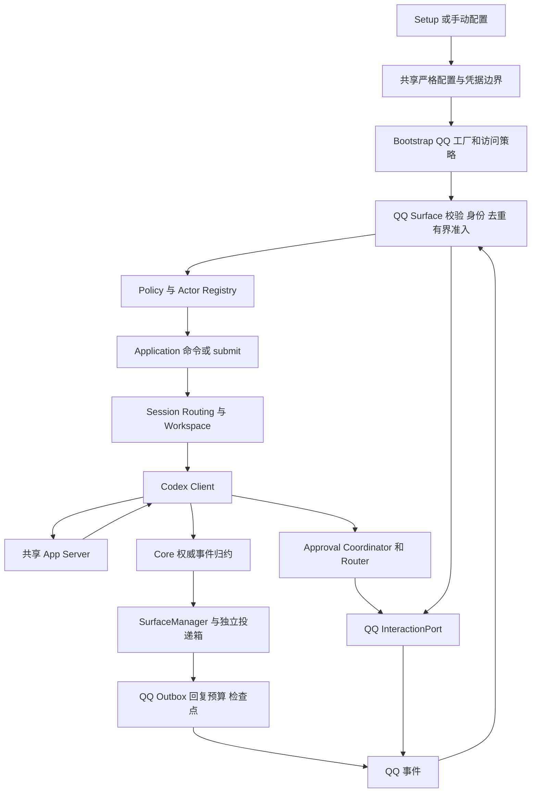

# QQ Surface 接入设计与全链路审查

## 状态与范围

本方案包含已接通的文本切片与后续适配计划；基础对话已有真实 QQ 证据，完整能力尚未验收。初始分析基于项目提交 `67a2735afb18f1e786d073ad9dfc8c7d49b8020c`，
资料核对日期为 2026-10-23。用户随后授权实施、扫码接入和部署；已引入锁定的官方扫码 Connector，
用户已完成扫码保存并反馈收到 QQ 回复；后续已通过用户实录、App Server 只读历史和绑定/日志交叉核对普通模型轮次。
这不代表全部命令、人工审批和异常路径验收。
官方资料和 SDK 的能力声明不等于目标账号可用；开放事项及完成门槛见本文末尾。

当前切片采用扫码或手工凭据与 WebSocket 窄协议，统一配置、Setup、Doctor、Policy、会话命令和可靠输出；
消息 SDK 继续作为锁定源码参考，Connector 仅用于 Setup。实现边界见 [QQ 模块合同](../src/surfaces/qq/README.md)。
提交关联以实际 submit 响应为准；提前到达的输出仅有界等待提交关联，失败保留未确认，不推测归属。
首片重启后隔离旧 ReplyGrant，不承诺自动恢复旧被动回复。审批暂用安全拒绝；Webhook、
完整交互、更多命令、图片、流式与新回复依据的显式恢复仍待后续切片，不把初版配置字段等同于下面全部候选设计。

后续目标为单 AppID、允许名单内的 QQ 单聊，在 QQ 官方能力内逐步对齐飞书与 Telegram 已接入的业务功能：
富文本、流式、会话与命令、人工交互、图片/文本文件/引用、可支持的音视频输入及可靠恢复。
具体顺序以[下一阶段计划](#推进顺序规划与实施状态)为准；未完成的切片继续明确不支持。
群聊、频道、多账号和默认主动推送不进入本轮路线。群聊需要重新决定共享 Thread、成员授权和全群可见的输出边界，不能仅增加事件名。

继续遵守[渠道接入指南](surface-integration-guide.md)、[可靠投递合同](delivery.md)和[协议能力索引](index.md)。
不引入 OpenClaw/DSH 宿主，不让 QQ 管理第二套 Thread、Turn、历史或审批状态；不修改 Codex 协议。

## 官方资料与 SDK 分工

本地副本及固定提交记录在[上游资料索引](upstream-sources.md#qq-接入研究基线)。资料保留在 `upstream/`，
不进入发布包、不作为直接源码依赖、不自动更新。新官方实现与旧官方 SDK 分开评估。

| 来源 | 已确认职责 | 本方案采用方式 |
| --- | --- | --- |
| `tencent-connect/qqbot-nodejs` 1.0.5 | 新协议 SDK；QQBot 高层门面、公开 `/protocol` 入口、WebSocket/Webhook、消息/媒体/单聊流式 | 主要协议实现参考与候选依赖；按公开能力逐项审查，不直接采用全部默认行为 |
| `@tencent-connect/qqbot-connector` 1.2.0 | 扫码获取 AppID、AppSecret，可返回扫码用户 OpenID | 仅为 Setup 的可选扫码入口；不是收发 SDK，不能代替运行时传输 |
| `tencent-connect/openclaw-qqbot` 2.0.4 | 使用上述两个 SDK 的 OpenClaw 渠道插件 | 参考装配、双传输与回复策略，不引入宿主、历史和 Agent 编排 |
| `tencent-connect/dsh-qqbot` 0.5.2 | 使用上述两个 SDK 的 DSH 插件 | 参考绑定、审批、问题和流式适配，不引入 Cordis/DSH 状态 |
| `tencent-connect/bot-node-sdk` | 旧频道 SDK，`v1` API 与 `Bot AppID.Token` 鉴权 | 不作为新渠道运行依赖 |
| `tencent-connect/botgo`、`bot-docs` | 旧官方实现与文档源码 | 验签/历史语义对照；不能覆盖较新的线上文档与新 SDK |

腾讯组织入口为 [tencent-connect](https://github.com/tencent-connect)。新版 SDK 的存在纠正了“官方只有旧 Node SDK”的判断。
默认不采用旧 SDK，也不因新 SDK 功能齐全就放弃本项目的取消、授权和持久投递合同。

### SDK 的实际适配边界

以下是固定源码观察，不是运行测试结论：

| 边界 | 固定源码证据 | 设计影响 |
| --- | --- | --- |
| HTTP | `qqbot-nodejs/src/protocol/api/api-client.ts` 的 `RequestOptions` 没有外部 signal/fetch 注入；`fetch` 返回后清除超时，再读 `res.text()` | 外层 `Promise.race` 不能取消底层传输，也不能约束正文；不能直接作为可靠写入客户端 |
| HTTP 成功 | 同文件主要按 HTTP 状态解析，成功体直接 JSON 返回 | 各方法必须另外校验业务码和必需字段，尤其 Token 的 HTTP 200 错误、异步审核响应 |
| 日志 | HTTP debug 会输出正文；错误包含原始服务端信息 | 不将 SDK logger 直通项目 Logger；仅输出本地分类和限长 TraceID |
| Webhook | `protocol/transport/webhook.ts` 对 Dispatch 启动后台处理后立即返回成功 ACK；验证挑战另走分支 | 需要本项目负责有界接收与 ACK 决策，不能用默认 ACK 表示已经安全接收 |
| 序号 | `protocol/api/routes.ts` 的 `getNextMsgSeq` 是随机/时间组合 | 项目必须自己拥有账号、消息和发送操作关联的序号分配及恢复，不拿随机序号冒充幂等性 |
| 生命周期 | `GatewayConnection.start()` 是运行期 Promise，实例为单次使用；配置可限定重连 | 适配为 Surface 启动就绪与后台运行两阶段；不能直接 `await start()` 当作启动完成 |
| 中间件 | SDK 提供 history、引用索引、授权、命令、格式化等可选能力 | 不启用重复业务状态和宽松授权；本项目复用 Policy/Application/Approval/InputBatcher |

公开 `/protocol` 已核对导出 routes、codec、`dispatchEvent`、`GatewayConnection`、Webhook 验签/挑战签名工具。
`dispatchEvent` 使用类型断言，不替代本项目的外部数据校验。`MessageApi.sendRaw` 可显式提供 msg_seq，
`sendC2CStreamMessage` 可传完整分片参数；但构造器依赖有 private 状态的具体 `ApiClient/TokenManager`，不是可注入的窄 RequestPort。
可评估通过公开子类覆写 request/token 方法连接受控执行器；这是尚未编译验证的候选，且每次发送仍无 signal 参数，
不得用共享可变 signal 连接并发请求。分片媒体另走内部 HTTPS，不被这种桥覆盖。

`GatewayConnection` 直接创建 WebSocket，没有公开 agent/factory；Token/URL 回调不能解决 WebSocket 代理。
其 seq 在业务回调前保存，异步回调失败只记日志，onRawEvent 也不包含完整 envelope；不能把 session 持久化视为输入已提交。
内置 Webhook callbacks 没有 raw 事件入口；只替换 server adapter 也不能补齐生命周期事件分发。
因此默认 Transport 只能在 G1/G2 证明接收、代理和取消合同后采用，不能默认视为可复用完成。
`StreamSession.complete()` 在末片请求前标记完成，失败后再调用会直接返回；cancel 只清计时器，
不取消在途发送与退避。可靠流式不采用该高层状态机，需由本项目顺序器掌握最终确认。

候选方案是优先复用上述公开协议原语，平台 HTTP、回复预算、检查点由窄 Adapter 负责。
实施前必须证明选中的运行能力能通过公开接口满足合同；若需要改 SDK 私有字段、全局 monkey patch、
导入内部文件或替换大部分实现，则不引入该依赖，保留固定源码参考并实现实际需要的窄协议。
不能为了“用了 SDK”引入仅供类型引用的运行依赖。具体可采用范围属于门槛 G1。

### DSH 与 OpenClaw 关联参考结论

已按固定提交追踪两个插件的 Setup、入站身份、审批、流式终态及回复额度调用链；以下均为源码判断，未运行复现。

| 参考路径 | 可以借鉴 | 不可照搬的触发与影响 |
| --- | --- | --- |
| DSH `src/setup/binding-service.ts`、`setup/persist.ts`、`src/index.ts` | 扫码状态、呈现、保存分离，刷新代次保护二维码显示 | 成功回调未核对刷新代次并只取数组第一项；保存失败仍可用内存凭据启动；错误指导可能输出 Secret。项目必须在实际提交边界复核且不泄密 |
| OpenClaw `src/setup/login.ts`、`setup/finalize.ts` | start/wait 分离，按账号管理扫码流程 | 旧 waiter 在 await 后删除同 key 当前会话；扫码用户自动加允许名单。项目要核对精确会话代次并由本地明确授权 |
| DSH `src/gateway/middleware-setup.ts`；OpenClaw `src/middleware/access-control.ts`、`gateway/event-handlers.ts` | 平台 sender 与 conversation 分开传递 | 空名单放行/转为通配符、审批 Actor 多字段 fallback。QQ 接入必须空名单拒绝，字段只认当前合同 |
| DSH `src/features/approval-channel.ts`、`button-utils.ts` | 有限决策与会话取消 | 按钮只有 allow/deny，没有请求随机 token；按当前会话 pending 路由，旧按钮可能作用于新请求；发送后才登记 pending。不得复制 |
| OpenClaw `src/features/approval-handler.ts` | 跨客户端 resolved 与账号注册 | 可批准的命令被截断，通用 always、发送后登记与计时；无 pending 也可发审批 RPC。必须改用本项目完整预览和 Router 合同 |
| DSH `src/transport/outbound.ts`、`streaming-writer.ts` | 串行节流 | 有 buffer 时忽略 durable 最终 content；部分成功后末片失败不触发完整结果保障，flush 后还清 buffer。不能据此确认最终回答 |
| OpenClaw `src/outbound/streaming-controller.ts` | 流归属与串行调度 | finalize 使用 lastAcceptedFull 而非权威最终内容，前缀修订会拼接旧文；末片失败可进入 done。项目不得修改答案语义来迁就流式 |
| 两插件 reply limiter 与 sender | 平台回复预算集中管理 | 过期删除记录后同 ID 可变成新额度，计时始于首次发送；超限自动去掉 msgId 转主动，DSH 还能借最新消息锚点。项目必须保守占额和精确归属 |
| OpenClaw `src/gateway/lifecycle.ts`；DSH `src/gateway/bootstrap.ts` | 资源集中归属、ready/disconnected 事件 | ready/resume 重建交互、断线仅日志不足以证明旧审批已撤销；QQ 恢复与 App Server 订阅恢复必须分开 |

不借鉴两个宿主的 session manager、history buffer、引用正文索引、JSONL 历史、全局自动批准命令或宽松输入门禁。
SDK 与两个插件均不是本项目完整性、授权或平台投递成功的证据。

### 当前官方合同与冲突

| 主题 | 当前资料 | 处理原则 |
| --- | --- | --- |
| 鉴权 | [访问凭证](https://bot.q.qq.com/wiki/develop/api-v2/dev-prepare/access-token.html)：AppID/AppSecret 换取 Access Token，`QQBot` 鉴权 | 固定当前官方域名；Token 内存缓存与合并刷新；不兼容旧 Bot Token |
| 传输 | [WebSocket](https://bot.q.qq.com/wiki/develop/api-v2/dev-prepare/event-emit/websocket.html)、[Webhook](https://bot.q.qq.com/wiki/develop/api-v2/dev-prepare/event-emit/webhook.html) 均有当前文档，新官方 SDK/插件也支持双传输；旧 BotGo 有下线说明 | 不再依据旧说明断言 WebSocket 不可用；首选评估无需公网的 WebSocket，目标账号实测后锁定；Webhook 为明确配置的替代方式，不自动切换 |
| 被动回复 | [概述](https://bot.q.qq.com/wiki/develop/api-v2/server-inter/message/overview.html)列单聊 60 分钟/4 次，群聊 5 分钟/5 次；[单聊发送页](https://bot.q.qq.com/wiki/develop/api-v2/autogen/api/v2_users_user_openid_messages.post.html)的 `msg_id` 字段却写 5 分钟 | 在确认前采用不超过 5 分钟的本地保守发送窗口；60 分钟不是交付保证；额度按消息来源计数 |
| 主动发送 | 当前概述描述主动消息和召回，用户可关闭接收 | 首版不自动从被动切换为主动/召回；SDK/插件的 fallback 不构成本项目授权 |
| Markdown | [格式页](https://bot.q.qq.com/wiki/develop/api-v2/server-inter/message/type/markdown.html)写明 2026-04-23 单聊/群聊自定义 Markdown 开放 | 不再把模板申请作为单聊通用前提；仍实测代码、链接和长度限制 |
| 按钮 | [按钮页](https://bot.q.qq.com/wiki/develop/api-v2/server-inter/message/trans/msg-btn.html)仍有模板申请/自定义按钮内邀描述 | 与 Markdown 权限分开；首版不能依赖所有账号都有自定义按钮 |
| 流式 | [流式接口](https://bot.q.qq.com/wiki/develop/api-v2/autogen/api/v2_users_user_openid_stream_messages.post.html)要求顺序分片，已下发前缀不可改 | 只流式追加正文，不把“处理中”替换为无共同前缀的最终回答；末片单独确认 |

这些冲突通过具体账号、SDK/文档版本和实际响应收敛；不使用放宽默认值或隐式别名掩盖。
Token 页还存在 `expires_in` 类型表为 number、示例为数字字符串的差异，解码允许范围必须在 G1 核定并显式列出，不使用通用宽松转换。

## 全链路与现有落点

| 路径 | 已核对入口/消费方 | QQ 关联调整 |
| --- | --- | --- |
| 配置读取与启用 | `runtime/gateway-config.mjs`、`src/config/index.ts` | QQ 严格结构、至少一个渠道启用条件、账号身份、URL/端口与凭据检查 |
| Setup 与管理读面 | `scripts/setup.mjs`、`scripts/config-summary.mjs`、`scripts/config-management.mjs`、`webui/src/pages/channels-page.tsx` | CLI 配置与 WebUI 状态同源；WebUI 当前渠道页主要显示状态和 CLI 引导，不凭空增加凭据编辑页面 |
| 装配 | `src/bootstrap/surface-composition.ts`、`surface-plugin.ts` | 显式内置插件，单实例 `qq + AppID`，不扫描插件目录 |
| 共享授权 | `gateway-component-graph.ts` 的 `accessPolicy`、命令守卫、`outputOwner/outputAuthorized` | 必须增加 QQ 策略分支；只注册 Adapter 会导致命令/恢复投递失败关闭 |
| 输入到 Turn | `src/application/conversation-service.ts` 的 `submit`、`submitInputLocked`、`startNewTurn` | 实时授权闭包贯穿会话锁和最终 RPC；活跃轮次走既有 steer，不自建下一轮输入队列 |
| 绑定和恢复 | `src/session-routing/router.ts`、`src/storage/sqlite-binding-store.ts`、Bootstrap 绑定恢复 | 使用既有前后台绑定；禁用保留、撤权清理与退订；新增渠道字符串本身不要求 Schema 迁移 |
| 输出 | `surface-manager.ts`、`persistent-surface-output.ts`、`surfaces/delivery-policy.ts`、`delivery-receipt.ts` | QQ 策略在统一入口决定；持久正文和瞬时状态分开；实际确认后才结算 |
| 审批 | `src/approval/coordinator.ts`、`interaction-router.ts`、`types.ts` | 复用请求归属、总期限、跨客户端失效；QQ 不复制审批状态机 |
| 图片 | `scripts/channel-send-image.mjs`、`bootstrap/channel-image-spool.ts`、Surface `sendChannelImage` | 显式图片现有入口缺少回复归属，须独立补齐 G3 合同后开放；上传成功不等于发送成功 |
| Hook 与计划任务 | 组合根 Hook 审查能力回调、`scheduled-task-composition.ts`、Surface 确认呈现 | 未证明完整预览的 Hook 写操作拒绝；首版不开放 QQ 定时推送，必须连同 Agent 的 schedule tool 入口门禁，不只隐藏菜单 |

这是相关入口、共享合同与关键实现的审查，不是整个仓库逐文件审计；上游 Codex RPC 语义沿用当前已接入合同，不新增协议能力。

## 输入 身份与接收确认

### 身份与授权

`surface=qq`，`accountId=AppID`，单聊 `conversationId=c2c:<user_openid>`；Actor 取当前事件中经过校验的用户字段。
平台 OpenID 不当作 QQ 号码，不假设群成员 ID 与单聊用户 ID 等价。事件账号来源必须能绑定到本 Adapter：
WebSocket 来自本账号鉴权连接；Webhook 校验原始字节签名，并核对有合同的 AppID 字段。
字段缺失、相互冲突、跨账号、非单聊场景或未知特权类型，拒绝进入 Application。

先授权，再记 Actor、解析可执行命令、下载附件和使用回复凭据。仅收到消息、扫码成功、机器人加好友都不自动加入允许名单；
扫码用户需在本机最终确认保存后才加入允许名单，且只采用本次返回的用户身份。
命令和普通输入都传实时授权闭包；异步等待后检查原 Workspace、目录和 Thread，复用现有提交守卫。
`/stop` 保持授权后的即时取消路径，不等待长附件或普通消息处理排空。

输入聚合使用 `SurfaceInputBatcher`，只合并同账号/会话/Actor 的已授权输入。入站平台消息 ID、事件 ID、
消息分片标识和下行 `msg_seq` 分开建模；不能把下行回复序号当作入站去重身份。
单聊事件文档对 `msg_seq` 与 `message_scene.ext.msg_idx` 有不同描述，最终去重键要以原始事件核对，缺少必要身份不提交。

### 接收与执行的非原子边界

Webhook ACK 仅表示事件接收；App Server 接受输入、Turn 完成、QQ 回答送达是后续独立阶段。
不能等完整模型执行后才 ACK，也不能无容量检查就成功 ACK 后静默丢弃。

设计选择是有界准入加保守防重，不承诺恰好一次：在提交 Application 之前，先原子记录最小接收身份和 `claimed` 状态；
业务执行结果确认后记录 `submitted` 或明确未提交。记录不包含消息正文、附件 URL 或审批内容。
重启看到 `claimed` 时按“可能已提交”隔离，不自动再次执行；要求用户核对 App Server 的会话后重新发起，不能自动制造重试 Turn。
已成功 ACK 但尚未执行时崩溃可能丢失该输入，必须在运维状态中显示未确认接收；不以历史缓存修补，也不声称无损输入。

接收登记的身份、有效期、容量、过期拒绝与平台重试时间必须一起确定：保留窗口内不驱逐已处理身份以重新执行；
容量满时拒绝新的业务准入并使失败可见。持久记录失败前不提交；写入结果未知不补发。
Webhook 正确的失败 ACK/重试合同、WebSocket 重放序列何时推进，以及无正文登记如何向用户解释未确认输入，属于 G2 的上线门槛。
本节为新增平台传输元数据设计，不宣称当前仓库已经有通用入站事务。

### Webhook 专属边界

只在显式选择 Webhook 时启用独立本机回调监听，优先回环地址加由操作者管理的 HTTPS 反向代理。
不自动创建公网隧道、不修改 WebUI 绑定地址、不暴露 App Server。路径、方法、Content-Type、原始正文大小、读取期限、并发数均有界。
签名基于原始字节，不使用 JSON 重编码结果；签名与账号校验在业务解释之前。
挑战请求与普通事件分开；挑战的认证要求、时间戳新鲜度和合法重投策略需对照新版 SDK、官方 Go 实现和真实回调收敛，
不能把默认 SDK 的免验签挑战直接当作安全合同。代理不得重写签名体，不信任任意 Forwarded 头授予权限。

## 凭据与配置生命周期

手工输入的 AppSecret 是静态应用配置，按既有合同保存在私有统一 TOML；自动取得的 Access Token 可再生成，仅驻内存。
扫码 Connector 返回的仍是同类 AppID/AppSecret，不是另一种 OAuth Token；发布类型没有承诺有效期或刷新凭据。
扫码和手工取得的 AppSecret 均保存到现有私有 TOML，不能照搬 README 示例打印 Secret。
两种来源在运行时复用相同的 AppID/AppSecret 验证及 Access Token 获取语义，不套用未被平台定义的 OAuth 生命周期。
手工和扫码是 Setup 的明确二选一输入方式，运行时共用现有凭据字段，不引入来源字段或读取回退。

当前配置字段为 `enabled`、`app_id`、`app_secret`、`allowed_user_openids`。
早期拟议的 `credential_source`、`transport` 及 Webhook 字段未采用。缺少配置保持禁用；出现未知字段、缺失启用必需信息立即拒绝。
当前启用状态、账号或凭据变化需要重启；允许名单仅新增成员可热载，移除成员需要重启，
与 `classifyQqConfigChanges` 保持一致。未来交互同样必须在撤权生效时取消，不能沿用旧授权。
禁用保留绑定和未确认结果，重新启用不自动放宽权限；撤权只影响精确账号和 Actor。

Connector 1.2.0 发布包已核验 npm integrity。其 README、类型及压缩代码表明它用 HTTPS 创建/轮询扫码任务并解密返回秘密，
没有消息收发能力；公开导出仅 `qrConnect/startQrConnect`。发布包标记 `UNLICENSED`、无 repository 字段，
但同组织两个官方插件明确依赖它，官方 README 明确提供 npm 安装及公开接口调用说明。
本项目按该说明引用锁定的 npm 依赖，不复制其源码，不发布新的 Gateway npm 包；不推定该包提供开源再分发许可。

扫码入口采用回调 API 并关闭 SDK 控制台打印，使用 Setup 自己的展示与脱敏结果；二维码 URL、绑定 task ID 和加密 key 不进入持久日志。
SDK 取消不会传递到其每次 HTTPS 请求，且已完成响应可晚于取消触发回调；Setup 必须用代次和总期限拒绝迟到成功，
不能只调用 `stop()` 就认为资源已退出。若公开接口不能满足退出和网络合同，应放入任务拥有的隔离进程并明确限时收尾，
或暂时只支持手工配置；不得全局替换网络函数。扫码返回数组严格限定首版单账号，不能默认取第一项；缺少 OpenID 不自动授权任何用户。

CLI、Setup JSONL、WebUI 状态和 Doctor 只显示凭据配置状态。保存和激活分开报告；确认及提交开始前取消不写入，
账号选择和配置修订变化使预览失效。进入保存后不承诺取消能撤销写入，须等待实际持久化结果结算。
当前不新增安全凭据后端与 TOML 的双资源事务：扫码返回同类静态 AppSecret，沿用已有私有配置原子写入、修订保护与清理告警。
配置已提交但返回失败时先读回核对修订及目标，不重复写入；并发修订使确认失效时重新开始，不覆盖较新配置。
保存前取消丢弃内存结果；手机端已完成的绑定不因本地取消而撤销。回滚使用扫码前保留的私有配置备份，无数据迁移或删除。
Doctor 是只读检查，不扫码、不刷新权限、不发送试验消息。Webhook 公网可达性与 QQ 账号真实能力在未观察时显示未知。

## 输出 回复预算与可靠恢复

### 传输客户端

每次 HTTP 操作使用平台窄接口：按当前官方端点构造路径，校验/编码 ID，拒绝非预期跳转，复用 Bootstrap 注入的代理感知 Fetch。
超时覆盖请求、正文读取和响应校验；总取消信号覆盖排队、刷新 Token、退避、上传和发送。每个响应有字节预算。
Token 刷新按账号合并，凭据换代后拒绝旧刷新结果；关闭不再发起刷新，日志不包含请求/响应原文。

只把经校验的结构化返回认作成功。非零业务码、缺失消息 ID、异步待审核、超时和网络断开不能伪装为送达。
自动重试仅用于能证明未接受或幂等的具体操作；HTTP 5xx、重复序号错误本身不证明上一条是否送达。
保留受约束的操作类型、HTTP 状态、业务码、TraceID；SDK 的 `Error.message` 不直接进入用户消息。

### 回复上下文和配额

按 AppID、Conversation、Actor、原入站消息建立有界 ReplyGrant，记录真实发生时间、截止时间、已预留序号及发送状态。
不能只存“当前用户最新 msg_id”：开始、steer、命令和旧后台轮次可能同时产生结果，必须保持对应的 Thread/Turn/请求归属。
同一输入批次包含多条来信时记录实际可用来源，不能把一条消息的额度乘给每个 Item。
额度在平台调用前持久预留；发送结果未知仍占用，只有明确未接受且平台合同允许时才能释放。重启不能重置次数或从首次读取重新计算窗口。

Application `submit` 返回前可能先发出 `turn.started`，所以不能等返回后才临时登记唯一回复来源。
实施需以提交前的有界关联句柄与最终 Submission/权威事件协调；旧结果不能被“下一条消息刷新了上下文”自动改投。
当前通用接口没有 QQ ReplyGrant 字段：优先在平台内登记并通过组合根已有身份钩子关联；若现有钩子无法证明归属，
需在 Application/Surface 公共合同增加平台无关的提交关联入口，并单独评审，不向 Core 塞 QQ 字段。该部分属于 G3，不能靠时序猜测实现。

无额度、过期、用户拒收或上下文不可恢复时，保留完整结果并显示未投递分类，不自动使用主动消息或召回。
后续用户新消息不自动授权把所有旧结果重发；显式恢复/重试仍复核原结果 owner、目标与新的发送依据。
已有 `codexc delivery`/WebUI 可供本机核对，不新增 QQ 消息历史库。

### 展示与检查点

QQ 的事件策略必须在 `surfaces/delivery-policy.ts` 明确，而不是继承 Telegram/飞书默认全量通知：

| 事件 | 拟定处理 |
| --- | --- |
| 完整回答、部分回答、明确错误、Turn 终态 | 可靠结果；完整正文优先，分片和终态各自等待实际确认 |
| 推理、计划、工具过程、CLI 输入镜像 | 首版不自动逐条发送；查询命令保留共享能力，减少消耗回复额度 |
| 审批、问题、MCP 交互 | 独立 InteractionPort；在既有关键操作后、非关键状态前排队，期限不延长 |
| 生成图片 | 仅媒体切片实现并验证后开放；文件内容与发送结果同属可靠投递 |
| 启动、配置、空闲、连接等通知 | 不默认假定可主动发送；无发送依据时保持可观测未投递，不能假确认持久配置事件 |

事件忽略策略在入箱前决定；已经入箱的结果不得因为策略变化静默删除。
正文完成与 Turn 完成是两个独立事件，不能为了节省次数让前者等待后者而堵住同会话投递队列。
首版可减少独立开始/统计通知；如将统计合并进正文，需要显式的合并所有权与结算设计，不伪造多个记录的检查点。

当前 `checkpointDelivery` 不识别 QQ 原始响应的 `id` 字段，QQ 客户端需把已验证结果投影成内部 `messageId`，
不能因 Promise 成功就丢失平台确认身份。长文本需要完整分片或受支持的完整原文附件；仅发送截断摘要不能确认完整正文。
回复次数不足时保留未确认结果，不承诺无限长度可交付。

流式以完整目标、Thread、Turn、Item 隔离；首片返回的流 ID、递增 index、稳定 msg_seq 和已确认前缀分开记录。
“正在执行”使用独立状态通道，不能作为需要删除的正文前缀。末片 `input_state=10` 成功才结束该流；
失败后不能把 `complete()` 已调用或 pending timer 清理当作已完成。没有幂等依据时，首片/续片结果未知不重发、不自动换普通气泡补发。
临时增量不落盘；跨重启流不能继续时，完整终态仍由共享投递箱保留，并按未知操作的核对规则处理。

### 媒体两条入口

入站图片先授权，再检查可信下载目标、重定向、大小、真实格式和私有暂存路径；下载完成到提交之间复核工作区、线程、取消和权限。
不让 SDK 任意 URL 下载器直接访问内网或本机文件；未支持的混合/二进制输入整条拒绝，不静默提取一部分执行。

出站自动图片与显式 `sendChannelImage` 分别接入既有可靠输出与 spool，复用 `readGeneratedImage` 的安全检查。
其中显式图片不能仅靠接入现有 spool 即开放：`ChannelImageManifest` 只有 threadId、imagePath 和 createdAtMs，
`processEntry` 解析目标后调用 `sendImage(target, path)`，SurfaceManager 最终仅传 conversationId/path；
这条链路没有原 Actor、Turn 或回复来源。普通 submit 的关联钩子不能弥补该路径的信息缺失。
因此 QQ 在 G3 完成前不声明 `sendChannelImage` 支持；开放时须将可验证的平台无关发送归属贯穿命令、manifest、
spool、组合根和 Surface 公共接口，并在实际发送前核验 owner、当前授权及 ReplyGrant。
不得从“该会话最新来信”或“Thread 当前轮次”推断旧后台图片的来源；manifest 版本变化须另行定稿数据兼容与恢复方案。
平台上传的 `file_info` 有时效且按场景隔离，不能把缓存命中当作图片发送成功；过期只重新上传仍可获得的任务图片。
文件暂存清理在确定提交/发送结果后按既有规则进行，结果未知不提前删除。首版不引入 ffmpeg、SILK 或新的音视频依赖。

## 审批 问题与 MCP

QQ 实现 `InteractionPort`，保留原 requestId、threadId 及协议实际提供的 turnId/itemId；子代理仍由共享 Coordinator 核验祖先后路由。
绑定 Actor、Conversation、账号、一次性随机令牌和单调期限；外部回调只提供选择，不反向决定审批对象或权限范围。
队列等待、发送和作答共同消耗 Router 的原期限，`resolved/cancelAll` 立即撤销有效性，消息删不掉也不能恢复令牌。

祖先路由只证明接收会话，不证明该请求具有可用的被动回复依据。当前 Ledger 仅关联普通 submit 返回的 Thread/Turn；
交互开放前须在 G3 分别定稿主 Turn、子代理、后台/异步及 `turnId=null` 请求的发送归属、额度和有效期。
不得用父 Thread 当前 Turn 或会话最新来信补齐缺失身份；不能证明 ReplyGrant 的分支继续安全取消并明确列为未支持。
实际发送前复核原审批期限与回复窗口，两者任一过期或额度耗尽均不得发送可批准的交互。

按钮可用时，`INTERACTION_CREATE` 还需要平台互动应答。Webhook 的 op=12、`PUT /interactions/{id}` 和 App Server 审批响应
是三种不同确认。仅处理当前支持的按钮类型和单聊场景；核对 `application_id`、用户和 token，重复回调不重复决定。
平台互动应答失败不重新执行已接受的授权决定。[互动事件及回应](https://bot.q.qq.com/wiki/develop/api-v2/autogen/event/interaction_create.html)。

没有按钮权限时，拟使用经过真实验证的一次性精确文本交互，复用共享预览与决策映射，不使用“同意/好的”等模糊词。
任何尚未完成的交互分支立即返回安全拒绝、空答案或取消；不能返回永不结算的 Promise。
用户问题保留 question ID、多选、可跳过和异步原 Actor；MCP 普通 form、URL 与 tool-approval 区分，不把工具批准变成手写 JSON。
secret 问题不能因 QQ 没有保密控件就当普通聊天收集，默认安全取消并引导原生客户端处理。

批准前完整展示共同层提供的内容与范围，超出平台承载能力就拒绝，不截断后保留批准按钮。
一次、会话、命令前缀、网络规则仅按原请求开放，stdin 仅一次/拒绝。平台清空聊天、切换模型、点赞等事件
不映射为 Codex 历史删除、模型修改或审批。Hook 写操作和计划任务必须在共享能力入口处明确门禁。

## 生命周期 存储与回滚

Surface `start()` 只在认证/监听就绪后返回；SDK 的运行期 Promise 单独跟踪，终止错误交给 SurfaceManager。
内层协议重连与外层账号恢复不能各自无限重试；给协议明确预算，耗尽后只由外层重建新实例。
临时故障取消当前交互和旧连接事件，不永久关闭可恢复的账号端口。迟到旧代次 READY/消息不重新公布就绪。

关闭顺序：撤销准入和就绪 → 停接收与重连/刷新 → 取消交互和待发送状态 → 有界等待已派发操作及元数据结算 → 释放监听与资源。
重复 stop 等待同一个结果；初始化途中关闭也进入该路径。超时不能释放仍在使用的容量或允许两个旧新实例同时发送。
Gateway 关闭不终止共享 App Server。网络/凭据/私有文件适配在 Linux/macOS/Windows 保持相同语义，Windows 仍沿用项目预览支持范围。

| 数据 | 拟定位置与合同 | 恢复/回滚 |
| --- | --- | --- |
| 静态配置（手工或扫码凭据） | 统一私有 TOML；同类 AppSecret 共用现有字段 | 原子修改、修订保护；扫码确认明确替换 QQ 配置，回滚先禁用 QQ 并核对配置备份，保留其他渠道 |
| Access Token | 进程内存 | 重启重新获取；不备份、不写日志 |
| 输入防重登记 | QQ 独立私有传输元数据，只有身份摘要/状态/期限 | `claimed` 不自动执行；到期清理必须配合拒绝过旧事件；未知版本失败关闭 |
| ReplyGrant/序号 | QQ 独立加密传输元数据，不含正文 | 发送前原子预留，未知发送保守占额；丢失/损坏不得重置后继续旧回复 |
| 最小会话绑定 | 现有 StateStore | 不迁移、不保存 QQ 原始消息；禁用保留 |
| 待发送结果 | 现有独立加密投递箱 | 复用 started/confirmed/rejected 与 uncertain；不另建结果数据库 |
| 审批 token/正文流 | 有界内存 | 重启失效，不重放审批或恢复模型增量历史 |

文本切片已实现版本 1 的加密 Ledger，包含账号、消息/Actor 身份、时间、序号、提交状态及 Thread/Turn 关联，
最多 500 条登记，重启不复用旧代次额度。后续交互、流式或恢复若需扩展持久格式，须在 G2/G3
定稿版本、兼容、备份和回滚方案；不隐式迁移，也不删除现有登记绕过不兼容。本轮计划编辑不修改用户数据。
备份需在 QQ 写入者停止并确认退出后，保留元数据、对应密钥和配置的同一快照，按各平台安全后端处理。
**不能把旧发送额度/防重快照直接恢复成可发送状态**：备份之后的外部执行不可回滚；恢复旧快照一律隔离旧窗口，
重新核对结果并等待新的受支持交互。回滚代码保留 QQ 元数据和未送达结果，不删除数据库来消除兼容性问题。

## 实施顺序与开放门槛

首个文本切片已有基础实机证据，以下门槛尚未全部通过，不把本地代码写成平台验收完成。
G1–G6 是各切片的适用门槛，不是开发顺序；更新后的依赖和交付顺序见下一阶段计划。
每个交付切片都必须记录真实成功路径和相关失败边界；无法观察的项目明确保留，不留下假成功占位。

| 门槛 | 需收敛问题 | 验收条件 |
| --- | --- | --- |
| G1 SDK 与平台 | 新 SDK 公开接口的实际采用范围；传输/代理、账号权限、Token 类型和业务成功规则 | 固定 npm 发布物与源码，逐项证明取消、正文预算、敏感信息和成功语义；不满足的能力明确替代或不支持 |
| G2 接收安全 | ACK、重投身份、时间窗口、防重登记和崩溃状态 | 重复/并发/重启输入不重复执行；已 ACK 未提交的丢失窗口可辨认；容量满和写入未知不假接收 |
| G3 输出关联 | 事件早于 submit 响应、steer/新轮、旧后台结果、ReplyGrant 恢复；显式图片命令到 spool/Surface 的归属缺口 | 每条发送有原 owner 和正确回复依据；不会用新用户/新 Thread 的上下文补旧结果；额度不因重启恢复；图片链路未补齐则不声明支持 |
| G4 交互 | 按钮权限、文本交互、秘密输入、完整预览、平台互动 ACK | 跨用户、过期、重复、跨客户端已解决、撤权、断线均不能生效；不支持时安全取消 |
| G5 长回答 | 流式计费、长度、末片、附件与主动能力 | 完整回答有实际平台确认；失败/超长保留结果，绝不把截断/上传/排队当作送达 |
| G6 运维 | Setup/Doctor/管理读面、禁用撤权、共享代理、跨平台关闭；静态凭据与配置同一 TOML 事务，保存与激活分离，并发修订及未知结果恢复 | 等价状态同源，提交前取消无迟到写入，提交后按证据结算；不以盲目重写/删除补偿未知结果；服务重启和元数据回滚不重置执行/发送安全边界 |

实施时的 Hack 输入包括：伪造 AppID/签名、原始字节变更、重复和乱序事件、缺失身份、过期窗口、流式前缀修改、
首片/末片超时、HTTP 200 错误体、限流、异常长度、未知响应、上传成功后发送失败、撤权与工作区切换竞争、
扫码取消后成功、SDK READY 晚于 stop、崩溃遗留发送和恢复旧备份。不新增测试文件或变相探针脚本。

真实用户路径必须观察：授权账号发消息 → 预配置 Workspace/Thread → 模型回答 → QQ 完整可见；
随后分别观察审批、停止、长文本、图片以及重启后的未送达结果。未经授权不使用真实账号发送，环境缺失时逐项标为未观察。
文档阶段只执行现有文档静态检查，不运行无关服务或测试；实现阶段另按实际范围执行静态门禁。

### 首个文本切片实施记录

2026-10-23，基于本工作区未提交实现：统一手工配置、Setup、Doctor 与 WebUI 状态投影，
QQ 窄 HTTP/WebSocket、账号授权、加密防重与回复预算、共享命令/submit/投递箱已接通。
运行依赖不增加 SDK；原生 RPC 仍走现有 Application/Client，不改变协议基线。
当前精确支持范围以 [QQ 模块合同](../src/surfaces/qq/README.md) 为准，初始完整范围中的交互及增强切片仍未完成。

已观察的真实本地用户路径是隔离 TOML 下的统一 Setup 终端交互：菜单选择、非法 AppID/名单拒绝、
隐藏 Secret、禁用保存、管理读面回读、同值不写、Ctrl+C 取消、另一入口竞争修改使确认失效。
保存文件权限为 600，输出未回显示例凭据；Doctor 仅报告 QQ 静态状态，隔离环境整体诊断因缺少服务仍失败。
直接调用真实加密传输登记观察到首次接收成功、重复拒绝、跨 Actor 无匹配、五片预留拒绝、四片原子预留、
耗尽不续额、重启旧来源拒绝；steer 不成为新的 Turn 回复来源。

独立只读审查发现的 Unicode 第五片、steer 续借、旧实例无法恢复和命令关闭守卫问题已由主代理调整：
完整分片先占额，仅非 steer 响应建立来源，外层重试重建已确认关闭的代次，命令实时守卫贯穿共享用例。
该审查不是修订后的第二次完整独立复审；修改后由主代理核对关联消费路径。
静态类型、模块边界、ESLint、构建及文档检查与真实行为证据分别报告，不新增或修改测试。
真实 QQ Token/连接/收发、Webhook/扫码、长运行后平台配额、网络恢复和 macOS/Windows 仍未观察；
G1–G6 未整体关闭，不部署、不操作真实账号。

### 提交前全链路关联审查

用户要求全链路分析、修复并提交后，按配置管理、协议/网络生命周期、输入/执行/可靠输出三个边界独立只读审查，
主代理核对共享调用链并修复。覆盖配置保存与热载、Doctor/WebUI 读面、Bootstrap 账号与代理装配、
WebSocket 准入与恢复、命令和 submit 授权、持久输出 owner、ReplyGrant、失败关闭及分发/静态边界。

- 修复 Resume 补发顺序：仅实际发出 Resume 的连接允许 RESUMED 前接收业务事件；入账后推进序号，RESUMED 后发布就绪。
- 每个 QQ 代次独占 HTTP 代理池；WebSocket CONNECT 的底层 TCP/TLS 连接绑定每次连接的取消信号。
  旧代次关闭未确认则不能创建新代次，不改动其他渠道代理生命周期。
- Setup 不再静默去重，空名单明确表示拒绝所有输入；Setup 与运行时共用 QQ 变更分类，名单新增报告热载、收缩报告重启。
- 已关联 Turn 的输出不再等待同会话无关的新提交；仅缺少关联时有界等待。
- 命令完成时同步捕获结果对应的工作区/Thread 授权，贯穿排队、Token 等待和最终发送；工作区切换回执绑定操作后的状态。
- 任一路径的传输登记写入失败统一撤销准入并关闭；正常本地命令标记 handled，避免重启后误报未确认输入。
- 保留受控协议故障分类和 HTTP 业务码；明确错误/拒绝与普通警告不再被 QQ 输出策略静默忽略。
  无法证明警告的 Turn 回复依据时仅保留待核对。现有模块边界静态检查也覆盖 QQ 跨渠道导入。

本轮新增实际观察：本机代理接受 CONNECT 但不返回响应时，取消 WebSocket 后对端连接关闭、剩余连接为 0；
HTTP 代理池关闭使在途 Fetch 返回 AbortError，对端连接同样归零，均未连接真实 QQ 或代理目标。
隔离 TOML 的真实终端 Setup 拒绝重复 OpenID；从一人增加至两人返回 activation=reload；
留空名单保存为零人并返回 restart-gateway。以上本地观察使用临时示例凭据，未启动 Gateway。
真实 QQ 的 Resume 补发顺序、账号权限与收发、平台错误响应，以及 macOS/Windows 实际关闭仍未观察。
当前环境为 Node 24.22.1；CI 固定 Node 22.23.4 的运行与打包行为未在本轮环境观察。

### 扫码入口实施与观察

2026-10-23，用户要求先走扫码连接，避免手工查找 OpenID。Setup 新增推荐扫码方式，
保留手工方式，两者共用已有 AppID/AppSecret 私有 TOML 合同、修订检查及保存结果。
这替代早期拟议的独立扫码凭据后端方案：不新增存储格式、不迁移用户数据，也不增加双资源事务。
最终确认前说明覆盖范围；扫码只授权本次返回的用户，缺少 OpenID、多账号和异常字段均拒绝保存。

新增锁定依赖 Connector 1.2.0，仅用于 Setup；官方 SDK 无代理注入点，明确直连 q.qq.com。
隔离 Worker 的 JS 堆设限，成功、失败及取消均等待退出；旧 Worker 关闭未确认期间拒绝新建任务。
五分钟总期限在消息消费时再次检查，避免迟到成功；SDK 内部响应未提供字节上限，JS 堆限制不等于原生内存硬上限。

实际观察：官方扫码接口返回二维码后取消，结果为 abort；预取消、非法期限及极短期限分别返回
abort、invalid-options、timeout。隔离 TOML 下真实终端选择扫码、确认并展示官方二维码后按 Ctrl+C，
向导返回「已取消 QQ 接入，未保存配置」，文件 SHA-256 前后相同，进程正常退出。
类型/模块边界、受影响 ESLint、文档索引检查通过。手机端完成扫码、真实凭据保存与 QQ 收发、
二维码到期刷新、Worker 关闭超时及 macOS/Windows 尚未观察；当前 Node 24，未覆盖 CI 固定 Node 22。

### 首次真实连接后的接收阻断修复

扫码用户反馈已保存配置但单聊无响应。只读状态确认 QQ 已启用、凭据存在、允许名单为一人；
Gateway 日志显示 QQ 就绪后报 invalid-payload 并重连。源码事件名校验只接受大写字母与下划线，
错误拒绝官方 C2C_MESSAGE_CREATE 中的数字，因此普通单聊在进入 Surface 授权前就会失败。
修复为大写字母开头，后续允许大写字母、数字与下划线，仍限制最多 80 字符。
该缺陷与现场日志吻合，但未记录原始平台消息，不能据此排除其他负载问题。

本机真实 WebSocket 手工观察中，READY 与 C2C_MESSAGE_CREATE 均进入分发回调；
带空格的小写事件名仍返回 invalid-payload，随后连接正常关闭。未调用模型或外部消息发送。
该阶段未提交、未重启服务。随后用户授权部署并重启 Gateway：安装副本的其余 QQ 文件与工作区一致，
仅替换 QQ 传输构建文件及映射，经允许的 restart gateway 入口重启，日志确认 QQ 就绪。
用户随后反馈「收到消息了」；具体回复是否来自普通模型轮次尚未确认。

### 扫码与真实接收修复的关联审查

用户再次要求全链路关联审查、修复和提交。独立只读审查覆盖扫码、Worker、配置事务及分发，
主代理追通配置投影与热载、账号准入、共享命令和 submit 守卫、回复来源/预算、可靠投递及关闭路径，
复用未变化链路的前序源码审查与本地观察。确认并修复两项补充问题：

- P2：扫码成功候选进入 Worker 收尾后，取消监听已移除，期间的取消可能被忽略。
  注册清理完成后和 Setup 接收结果后均重新检查取消；关闭失败仍优先报告。未绕过最终保存确认。
- P3：禁用到禁用时修改配置，运行时变更为空却报告热载。
  现在保留 configured 保存结果，activation 为 none，并独立提示已保存、仍禁用，无需激活，
  不套用共享 none 文案中“文件未写入”的无变化语义。

隔离 TOML 的真实终端操作已观察禁用保存，返回 configured/activation=none；共享读面回读
enabled=false、允许用户数 1、文件权限 600。此次未再次扫码或发送外部消息。
取消成功收尾竞争依据源码双重守卫修复，未人为制造平台成功回调竞态；跨 OS、Node 22、
完整模型轮次、配额耗尽及平台断线补发仍不声明实测通过。扫码旧存储方案和未支持描述已同步纠正。

## 真实对话核对与下一阶段推进

### 2026-10-23 实测核对

基于提交 `1dff82d2` 的接入实现及已部署的 C2C 事件名修复。用户提供了普通对话、追问、
`/help`、`/status` 和两轮审批尝试的 QQ 实录；主代理通过现有 Transport 只读调用 App Server
`thread/read`、`thread/turns/list`，并读取 Gateway 绑定和日志交叉核对。未重跑命令、未修改配置或会话，
未读取 Codex 内部会话文件；检查结束已关闭本次连接。

- **已证明的路径**：扫码后保存配置、QQ 就绪、普通输入进入模型、最终回答与轮次完成到达 QQ；
  `/help`、`/status` 正常返回，追问使用相同 Thread 的历史。此后不再把整个 QQ 收发标为“未观察”。
- **历史来源**：该 Thread 的早期 T1/Q2/T3 验收内容确实存在，T1 被中断、Q2/T3 完成。
  日志表明此前由 Telegram 使用，空闲解绑后才绑定 QQ；当前只绑定 QQ，没有发现同时绑定两个渠道。
  现有共享 Router 会自动选择同工作区、空闲、未绑定且 Provider 可用的历史 Thread，未限定历史渠道。
  该现象符合现有规则，但首次接入继承旧历史缺乏明确提示；是否改变默认选择属于共享会话产品决策，不能在 QQ 内旁路处理。
- **“操作未完成”的来源**：相关轮次中，创建临时文件和删除均 completed/exit=0；
  随后的文件存在性检查 failed/exit=2，输出为文件不存在。QQ 通知对应的是这次检查，不是审批拒绝。
  模型关于执行和删除的描述与记录一致；这些执行结果不足以证明每次都经过自动审查，更不能推出“审批基本不设卡”。
- **展示缺口**：失败通知只显示 command 与精简路径，未区分拒绝、执行失败和整轮失败；
  `/status` 直接输出完整 Markdown 诊断，手机阅读负担大；每个短答后额外发送“本轮已完成”，增加消息和回复预算消耗。
- **未验收**：人工审批/拒绝、问题交互、停止与恢复、跨工作区并发、长文本/配额、平台断线补发及跨平台关闭。
  不用真实敏感文件操作制造拒绝，审批验证应使用用户明确同意且即便获准也无破坏性的请求。

### 推进顺序（规划与实施状态）

本节以项目当前飞书/TG 模块的职责、共享接口和用户路径为实施主线，QQ 负责渠道差异。
上游资料用于核验具体协议、格式和限制，不用于决定模块拆分、命令语义或开发顺序；不复制 CardKit、Telegram 消息编辑或主动通知假设。
计划初始基线为 `1dff82d2`，整理提交为 `d6c09cb8`，输出适配提交为 `87a6b11b`；用户已反馈部署重启，实际证据与剩余验收见下文开发记录。
P2 基础接入说明与诊断已实施，范围见下文记录；其他未交付部分仍为规划，不得据此开放能力。
P1/P2 的本地实现不能升级为 QQ 实机通过。

#### 设计偏差记录与方案纠正

此前实现把输出适配简化为“字符串检查通过就发送 Markdown，否则整条原样纯文本”，没有先对齐飞书/TG 已有的
正文转换、字面字段保护、Outbox、分片和可靠确认职责。结果是正文反引号、时区下划线和正常命令提示反复触发整体降级；
后续逐字符放宽、逐条补标题和列表，也没有及时处理共同原因。这是实施分析和模块设计不足，不能仅归因于 QQ 平台限制。
底层共享授权、Application、会话与投递架构继续保留；`87a6b11b` 的内容转换和额度规划是已完成修正，不视为全部模块对齐完成。

后续以以下项目模块作为对照入口。实施前阅读对应实现及调用方，不能只按文件名复制；共享逻辑直接复用，
只有确属同一职责且存在当前需要时才提取共享能力，不从其他渠道内部导入实现，也不为 QQ 预建一套通用框架。

| 适配边界 | 项目现有对照入口 | QQ 的职责与对齐要求 |
| --- | --- | --- |
| 输入与提交 | 飞书 `inbox.ts`，TG `bot.ts`，共享 Application/Policy | 平台事件解码、Actor 授权及去重后调用同一输入/命令接口；保持原 Workspace/Thread 归属 |
| 命令结果 | 飞书 `renderer.ts`，TG `command-renderer.ts`，共享 `conversation-command-renderer.ts` | 沿用命令、参数和结果，不另设 QQ 专属业务入口；只适配显示和当前可用交互形式 |
| 正文与字面内容 | 飞书 `message-content.ts`、`outbox-content.ts`，TG `markdown-format.ts`，共享 `markdown-fence.ts` | 对齐正文结构转换、代码/路径/字段原义与可读降级职责；QQ 格式由本渠道实现，不能靠整篇字符白名单 |
| 生命周期与操作 | 两渠道 renderer/format、共享 `lifecycle-presentation.ts`、`operation-presentation.ts` | 相同事件使用相同状态和字段，不在 QQ 重建完成统计或错误语义 |
| 编排、分片与确认 | 两渠道 `outbox.ts`、`text-streams.ts`，共享队列、delivery policy/receipt、persistent output | 先对齐事件顺序、取消、未知结果和完整确认，再将 QQ 回复来源/额度约束接入规划；不新建平行业务队列 |
| 交互与附件 | 两渠道 `interactions.ts`、媒体输入/输出及共享暂存能力 | 先核对共享请求身份、授权、取消与文件合同，再适配 QQ 按钮/文字回应和媒体接口；当前未开放项不提前启用 |

每个差异必须落为“直接复用、QQ 局部适配、共享合同缺口、暂不支持”之一，并记录输入到最终消费路径及验收。
上游文档只在对应渠道边界回答“字段怎么发、格式能表达什么、限制是什么”；平台有某 API 不自动成为开发任务。

下一工作批以已部署版本的正文、命令结果、完成消息为同一条用户路径，对照上述前五项核对实际行为与模块职责；
先收敛现有通用能力，再评估交互、附件、流式等差异。发现不一致时按负责模块修复并检查共享调用链，不再按截图字符单点修补。

#### 官方能力与现场证据

2026-10-23 重新读取[消息类型总览](https://bot.q.qq.com/wiki/develop/api-v2/server-inter/message/type/overview.html)、
[Markdown](https://bot.q.qq.com/wiki/develop/api-v2/server-inter/message/type/markdown.html)与
[单聊流式](https://bot.q.qq.com/wiki/develop/api-v2/autogen/api/v2_users_user_openid_stream_messages.post.html)当前页面：

- 单聊文本、图片、文件、语音、视频支持收发；Markdown 支持发送；引用消息支持接收。
  发送的 `msg_type` 与接收的 `message_type` 不同，附件通过 `attachments` 表达，不能按发送类型解码输入。
- Markdown 页明确 2026-04-23 起单聊/群聊自定义 Markdown 向所有机器人开放，无需申请模板。
  按钮资格仍单独核定，不能从 Markdown 开放推导按钮可用。
- 流式有独立接口及 `stream_msg_id/index/input_state` 合同；已发送前缀不可修改。
  不把普通四次回复预算直接套给每个流式分片，也不在未核定前承诺流式无限额度或长度。
- 本次读取当前配置后，请求 Token 与 `/gateway` 均为 HTTP 200，返回有效凭证及安全 WebSocket 地址。
  只输出脱敏状态，未开启第二条连接、未发送平台消息、未修改配置。该证据只证明鉴权和发现，
  不证明 Markdown、流式、按钮或媒体的账号实机表现。未核对到统一账号能力查询接口前，不虚构自动权限探测。

#### 飞书与 Telegram 对齐矩阵

基线来自两渠道模块 README、Surface 共享合同及[统一验收矩阵](channel-acceptance-matrix.md)。
“已有实现”与“已有实机”分开；另一渠道的成功不能代替 QQ 实测。实施每行前继续追踪实际调用链，
本矩阵是规划对齐，不是对两渠道全部代码重新审计。

| 功能族 | 飞书 / Telegram 现状与可复用语义 | QQ 目标与适配差异 | 阶段 |
| --- | --- | --- | --- |
| 富文本、状态、帮助、失败 | 飞书 CardKit/Post，TG HTML/Rich Markdown；共享结构化命令结果和状态字段 | 原生 Markdown，明确格式不支持时受控降级；复用共享命令参数与结果；区分单操作失败、拒绝、取消及整轮失败 | P1 |
| 开始、过程、重试、完成统计 | 已有共享生命周期与重试呈现；各自流状态机，重试呈现尚待部分实机 | 同一事件语义；按 QQ 发送依据与额度选择呈现，非关键状态可合并；正文和终态独立结算，不逐条复制其他渠道通知 | P1/P3 |
| 工作区、会话、模型/Provider、effort/fast、用量 | 共用 Application/Session Routing；原生菜单保存精确目标快照 | 文本命令与菜单结果一致；首次进入显示当前上下文；旧菜单不得作用于新 Thread 或其他 Provider 同名模型 | P2/P4 |
| 持续回复与长文 | 飞书原生流式卡，TG 消息流；长文完整附件已有分项实机 | QQ 原生单聊流，完整终态为准；长文附件与预览分开确认，预算不足保留结果 | P3/P5 |
| 命令、文件、权限、网络、工具审批 | 共享审批语义；命令主路径已有实机，其他类型按矩阵保留差异 | 完整预览、一次/会话/规则范围精确映射；按钮或明确一次性文字交互；不能扩大上游范围 | P4 |
| Plan 问题、异步问题、MCP elicitation | 飞书卡片、TG 按钮/文字回复；MCP 表单/URL 仍有待验收项 | 复用 InteractionPort、pending registry 和交互文案；引用/令牌定位，已失效回答不得变成普通模型输入；敏感输入转原生客户端 | P4 |
| Queue、Goal、Review、固定/搜索/命名、归档等会话命令 | 共享命令目录与 App Server 权威状态 | 按目录逐项核对查询、写入、确认及可能启动 Turn 的入口；先补齐提交关联，再开放，不只扩大命令白名单 | P4 |
| Skill/MCP/Plugin、Hook、Auto-review 设置 | 两渠道已有对应入口，实机状态不同；共享授权及确认 | 对齐现有公开命令和作用范围；不新增市场安装等未支持语义；Hook 完整变更预览，自动审查状态不冒充 QQ 人工审批结果 | P4 |
| 图片、图文、多图、引用 | 两渠道图片与引用已有实机，按平台原生结构聚合 | 严格解析 QQ 附件与引用结构，保留原文和关联；同一事件多图同次输入，独立消息不按时间猜测合并 | P5 |
| UTF-8 文件、生成图片、显式发图 | 共享文本暂存/图片校验；各渠道验收范围不同 | 文本内容验证、长文文件输出、自动图片先行；显式发图需先补 owner/Turn/ReplyGrant 贯穿 spool 的缺口 | P5 |
| 音频和视频 | 音频受模型目录 `audio` 限制；视频走独立 MCP，非直接模型视频输入 | 复用格式、大小、取消、暂存和模型能力检查；不因 QQ 可收就宣称模型可处理；不新增转码依赖 | P6 |
| 连接、重启、撤权、恢复 | 独立 Surface 生命周期及共享投递恢复；故障仍有待验收项 | 就绪和配置分开；重连不恢复旧额度；过期/未知结果显式处理，不能借最新来信自动补发 | P2/P7，安全门槛贯穿全部阶段 |
| 计划任务与通知 | 已有共享任务入口，部署验收未全部完成 | 受主动发送、接收开关及授权约束；先研究可靠投递合同，未满足前命令与 Agent tool 均维持拒绝 | P7 决策门槛 |

共用 `ConversationCommandResult`、共享命令目录/格式器、`lifecycle-presentation`、
`turn-retry-presentation`、`InteractionPort`、`interaction-copy`、`pending-interaction-registry`、
媒体/文本暂存及可靠投递接口。QQ 拥有自身协议客户端、渲染、流式状态机、交互适配和回复额度。
不跨模块导入飞书/TG 内部文件，不为形式统一抽取通用流式基类，也不新增动态插件加载框架。

#### 补齐文档后的实施约束

本轮按用户授权统一下载并校验官网消息收发及关联资料，包位置、清单哈希和排除项见
[上游资料索引](upstream-sources.md#qq-接入研究基线)。三个独立只读子代理分别核对文本/流式、媒体/交互及
飞书/TG 共享消费合同，主代理对报告中的关键位置复核后补充本节。下载和源码核对不代表目标账号实机通过，
不替代 P0 的分项核定；旧资料和 SDK 提交保持不变。

**P0/P1 文本与 Markdown：**以[单聊发送接口](https://bot.q.qq.com/wiki/develop/api-v2/autogen/api/v2_users_user_openid_messages.post.html)
定义显式文本/Markdown 输入联合：文本用 `msg_type=0/content`，自定义 Markdown 用 `msg_type=2/markdown.content`，
不混传 `content/markdown/ark`。消息依据为入站 `d.id`，事件依据为外层事件 ID，二选一，不能把两者当别名。
自定义 Markdown 不使用模板；格式页仍有模板示例，而发送页已标模板 ID 废弃，不用模板权限错误否定自定义 Markdown 能力。
首批采用官网明确列出的标题、强调、链接、列表、引用等语法；代码、表格、HTML 等未列语法及转义规则待实测，
不能把“未列出”写成“官方不支持”。命令结果的字面字段和模型正文分别处理；现有 3000 字节机械切片不能直接套用富文本，
须保持分片信息完整及格式边界。当前本地字节预算和 SDK“约 5000 字符”注释都不是官方上限。

格式降级只适用于已确认未接受且允许再次发送的具体格式拒绝；HTTP 成功码、业务码和消息身份共同判断。
`40034011/40034124` 等格式错误与长度、去重、窗口/次数、拒收错误分别分类；超时、5xx、异步审核和未知结果不得自动改成纯文本重发。
公共错误文档列出的 201/202 与待审核状态不能当普通同步送达成功，具体发送路径仍按其接口合同核验。
验收包含特殊字符、中英文、四字节/组合字符、长内容、已确认格式拒绝以及结果不确定，不为制造限流向真实账号刷消息。

**P0/P1 候选输入状态：**单聊发送页定义 `msg_type=6/input_notify`，`input_type=1`，持续时间最长 60 秒。
该能力可用于独立“输入中”状态，但是否占四次预算、刷新及清除语义尚未确定；核定前不启用周期刷新。
类型总览没有完整列出此类型，应以具体接口为字段依据。输入状态不占正文前缀，也不能当模型或发送完成证据。
Markdown 还可包含平台指令标签；P1 普通模型回答和不可信字段须中和可执行标签，不能因切换富文本就自动开放交互能力。
仅 P4 经授权的呈现器可生成受约束的交互标签，并继续沿共享命令/交互入口验证。

**P3 流式：**[流式合同](https://bot.q.qq.com/wiki/develop/api-v2/autogen/api/v2_users_user_openid_stream_messages.post.html)
包含 `append/replace`、`text/markdown`、从零递增 index、服务端流 ID、生成/结束状态和可选 `remain_msg_len`（字符数）。
剩余长度缺失保持未知，不能当无限或 UTF-8 字节数；响应不提供精确已显示前缀长度，不能认为提交的全文均已显示。
单聊 60 分钟/4 次与字段 5 分钟冲突仍未解决，继续现有保守窗口；流式计次、总长、缺号/重复片和重试接受规则单独核定。
锁定 SDK 的 `StreamSession` 默认把消息 ID 同时作为 `event_id/msg_id`，与官网二选一合同冲突；其类型仅覆盖 replace/Markdown，
且未完整覆盖剩余长度等字段，不能直接作为新合同。SDK 的限流时推进 index 不是官方可靠性保证。

**P4 消息交互与原生菜单：**[互动事件](https://bot.q.qq.com/wiki/develop/api-v2/autogen/event/interaction_create.html)
单聊身份采用 `user_openid`，核对 App、scene/chat_type 和事件类型；不能用频道的 `resolved.user_id` 替代。
单聊示例不保证携带原消息 ID，使用自有随机令牌定位请求；按钮权限和已废弃的 click_limit 都不能代替服务端一次性校验。
互动 ACK 使用 `d.id`，不能带事件名前缀；type 11/12 的应答与其他平台事件分别处理，ACK 成功不代表批准。
当前资料未给出确切应答秒数，须核定期限；不对未执行的清空等动作盲目回复成功。
[Markdown 指令标签](https://bot.q.qq.com/wiki/develop/api-v2/server-inter/message/trans/text-chain.html)
可直接发送或填入输入框，参数上限与编码按官网合同验证，可作为文字令牌呈现候选；不是回调按钮，不机械套用互动 ACK。

[全局菜单](https://bot.q.qq.com/wiki/develop/api-v2/autogen/api/v2_menu.put.html)是 App 级完整替换，对所有用户生效；
[面板](https://bot.q.qq.com/wiki/develop/api-v2/autogen/api/v2_panels.post.html)可限定 C2C 用户，但配置与关联分开修改，
有机器人级容量限制，命令项只保证把名称填入输入框。两者只规划静态入口，不放 Actor/Thread/Provider 动态快照或审批令牌。
精确会话选择仍用消息内按钮或文本令牌；菜单点击不默认等于某种互动事件。
发布菜单/面板属于独立账号范围写入切片，须读取、确认实际覆盖范围、写入并回读，不随 `/model` 或会话切换自动改全局配置。

**P0/P5 媒体与素材：**第一批普通可靠图片/文件优先采用
[单聊 files 上传](https://bot.q.qq.com/wiki/develop/api-v2/autogen/api/v2_users_user_openid_files.post.html)取得不透明 `file_info` 后发送，
固定 `srv_send_msg=false`，不借上传自动发主动消息。平台硬限制不替代本项目更小的输入/暂存预算；
`raw_url` 并非所有上传类型必有。真实响应的 ttl=0 与 SDK 缓存伪造 ttl=0 必须区分，缓存不能延长平台正 TTL，
保守按 App/场景/目标/类型/内容隔离，不假定可跨单聊目标复用。

[Markdown 素材管理](https://bot.q.qq.com/wiki/develop/api-v2/server-inter/message/material-management.html)是独立的
prepare → 预签名 PUT → complete → `qqbot-media://` 引用协议，不与 file_info 共用生命周期。
当前文档限定单图 10MB、单机器人 100 图、上传任务 4 小时、图片 90 天未使用滑动过期；预签名 URL 按实际有效期，
preview_url 不持久化，不能跨机器人引用。图文使用该协议时另立切片，不自动删除用户既有素材腾容量。
complete 不保证图片真实字节可用于最终消息；图文可靠发送启用 `markdown.force_verify_image_resource=true`，
仍分别核验内容、上传和消息确认。201/202 或 `304023/304024` 待审核保留未确认与占额，不重发；
本批资料未建立单聊审核结果与原操作的完整关联，不能复用频道 MESSAGE_AUDIT 自动结算。

[单聊分片准备](https://bot.q.qq.com/wiki/develop/api-v2/autogen/api/v2_users_user_id_upload_prepare.post.html)写明零起始 index、
字符串尺寸及嵌套 upload_config；锁定 SDK `media-chunked.ts` 使用 `(index - 1)` 偏移、数字尺寸和顶层配置，
合并时文件名也需按当前接口重新核定。`upload-cache.ts` 的最小 10 秒余量可能延长短 TTL，缓存命中又生成 ttl=0。
这些是源码与文档冲突，不是实机故障结论；P0/P5 先明确合同再选受控客户端，不能以隐式宽松兼容掩盖差异。

**P5 引用与 P6 音频：**引用按 C2C `message_type=103/msg_elements` 原生递归结构校验，限定深度、元素数和总内容预算；
嵌套作者不能替换顶层 Actor，引用正文不成为命令或审批选择。未知并行/聊天记录或卡片结构不提取部分文本执行；
场景 ext 中可能有 auth_token，必须隔离脱敏。出站 message_reference 的索引：用户消息取 msg_idx，机器人消息取 ref_idx，
不能用入站 d.id 或发送回执 ID 替代；仅保留任务需要的有界关联，不建正文索引。
语音附件的 voice_wav_url 可作为免本地转码候选，仍须安全下载、实际格式、预算和取消校验；
asr_refer_text 仅是参考，不当作准确原话或用于绕过 audio 能力/下载失败。ARK 发送无当前必要需求，权限与结构单独核定，后置处理。

**P1/P4/P5 共享消费对齐：**

- P1 必须区分 `status=completed` 与 `missingFinalResponse`，复用共享“无最终回复”语义；完成摘要不能证明正文已送达。
  当前无 Turn 回复依据的 warning 仍为受限保留，不泛称所有警告可发送。
- P4 按 Application 实际命令目录逐项登记，覆盖 `/agents`、`/release`、`/compact`、`/revert`、`/limits reset` 等，
  不能仅按其他平台菜单复制白名单。共享业务确认与 App Server 审批不同；例如账户消费继续使用共享选券/确认合同，
  不因人工审批接通就放开写入。相关源入口为 `conversation-command-service.ts`。
- P5 图片经共享 `SurfaceInputBatcher` 构造已验证 Data URL，Application 在提交前检查当前模型 `image` 能力，
  Client 负责精确 Provider 的引用准备：OpenAI ChatGPT/受管 DS 使用既有引用路径，其他 Provider 按现有合同 inline。
  QQ 不把平台 URL、本机图片路径或自取 file_id 当模型输入，不在引用准备失败时隐式降级；验收含不支持 image、准备取消及目标/授权变化。
- 生成图片仅有引用、没有可读路径时，复用“图片已生成，但当前无法获取图片内容”结果，hidden 也保留该提示；
  持久快照保存不可获取标记并剥离引用，不能称已发送或静默省略。可读图片才进入安全读取与实际投递。
- 文本文件复用共享 UTF-8/文件名/控制字符校验及暂存合同：小文本内联，大文本供执行端按需读取，
  不承诺任意文件全文进入模型。引用经 `quoted-input` 有界呈现，与当前内容分离，不参与斜杠命令解析，
  本批引用适配不自动下载引用附件，也不扫描会话历史补齐缺失内容。

#### 分阶段交付与依赖

| 阶段 | 范围、落点与依赖 | 可观察的完成条件与失败边界 |
| --- | --- | --- |
| P0：项目模块与渠道边界核对（逐批） | 先追踪飞书/TG 对应模块、共享合同和 QQ 现有消费路径，确定复用或适配责任；仅对本批渠道差异核验官方字段/权限/限额。真实发送需授权和有效回复依据，不另开生产连接 | 每个差异有责任模块、完整路径及观察方式；分别记录文档支持、接口结果、客户端表现，不以平台能力目录驱动功能扩张 |
| P1：原生 Markdown 与准确输出（本地实施，待实机验收） | QQ protocol/rendering、共享命令结果与 delivery policy；帮助分组，状态沿用共享命令，不添加专属参数；失败呈现保留可用退出码与脱敏详情；复用共享完成结果并遵守回复预算 | 手机端确认标题、列表、链接、代码等实际表现，不假定完整 CommonMark；特殊字符、长内容、明确格式拒绝及未知发送结果有明确行为。正文不等待 Turn 完成；已入箱完成事件不能直接删除或假确认 |
| P2：接入和会话闭环 | Setup/Doctor/管理读面/Surface 健康；状态为取得凭据、保存、激活、连接、首收、首回；新建与恢复路径可见。依赖现有配置事务，通常不依赖 P3 | 用户从扫码到首答能辨认失败所在阶段；扫码取消、配置竞争、凭据失效、断网、重新扫码替换名单均可解释。确认后才改变配置；已有绑定保留。首次默认新建与否先做跨渠道决策，不静默改变 TG/飞书续接 |
| P3：原生流式与长任务 | 依赖 P0 流式核定及 P1 输出语义；QQ 独立顺序器、首片身份、增量、末片确认；共享重试/停止/终态信号 | 真增量到达且最终正文完整；首片未知、前缀修订、末片失败、限流、取消、断线可辨认；不靠最终消息模拟流式，不在未知结果后自动重发普通气泡。无流权限时保留明确配置的完整最终回复路径 |
| P4：交互与命令对齐 | 依赖 P1 完整预览、P0 按钮/文字回应核定及适用于交互的 G3 回复归属；可独立于 P3 开发。分别核定主 Turn、子代理、后台/异步及无 Turn 请求；先命令/文件一次审批及普通问题，再权限/网络/工具审批、异步问题/MCP，最后按共享目录补其他命令及原生菜单 | 无害真实请求完成批准、拒绝、取消；复核 Actor/请求/Thread/协议提供的 Turn、期限、重复、跨客户端解决和撤权；路由有效但无发送依据、排队期间回复窗口到期/耗尽必须安全取消，不计作交互实机成功。菜单固化原目标与选项；额外 Turn 命令完成关联才开放；旧交互文字不作为普通输入 |
| P5：图片、引用、文件与长文 | 依赖 P0 媒体核定及 G3；先入站图片/引用/UTF-8 文件，再生成图片与完整长文附件，显式发图单独补共享归属合同。附件兜底不强制依赖 P3 | 真实图文进模型并回复；同条多图/引用保留语义；类型伪造、内网 URL、重定向、超限、下载中 stop/换工作区/撤权拒绝；上传成功但发送失败不得结算，长文附件内容完整并保持顺序 |
| P6：有条件的音视频输入 | 在 P5 下载与取消边界上复用 managed-audio/video store；按当前共享能力接音频或视频 MCP | 模型不支持 audio 时 Turn 前明确拒绝；视频进入既有 MCP 路径；格式、时长、大小、关闭和迟到下载有界。语音输出、实时音视频及任意 Office/压缩包继续不支持 |
| P7：恢复与通知收敛 | 各阶段均先满足重启/未知结果安全；此阶段新增用户显式结果恢复、渠道运维体验，并决定计划任务/主动通知是否可开放 | 原结果 owner、Thread 与新发送依据均可证明；旧结果不占用任意最新消息，恢复不重置额度。计划任务只有发送授权、拒收、预算、重试及可靠确认都明确后另列实现切片；否则保持未支持 |

P0–P7 保留为范围与依赖编号，不再作为按 QQ 上游 API 分类推进的固定顺序。
当前顺序为：项目模块对照 → 已部署 P1 通用输出闭环 → P2 接入/会话差异 → 按共享用户路径评估 P4/P5/P3，最后再评估 P6/P7。

实施优先级按用户最新要求收敛：先完成现有统一通用能力的 QQ 接入，命令、状态、操作错误、完成结果和业务授权复用现有实现；
QQ 层仅适配协议、呈现、回复依据与额度。完成通用能力后再核对缺项，后续阶段中的 QQ 专属能力暂不提前展开。
P0 只做即将实施能力的核定，不要求先发送所有类型；每一批都包含自身失败/取消/恢复边界，P7 不承担前面遗漏的可靠性修复。
图片、文件、引用优先于音视频；群聊、频道、多账号、Webhook 替代传输不阻塞本路线，也不借此自动开放主动发送。

#### 验收、记录与交付规则

1. 每批实施先确定飞书/TG 的对应责任模块与共享合同，再列 QQ 平台差异、输入到最终消费的路径及所需上游核验。
   能力声明只在实现与对应观察完成后改变；未观察边界在统一验收矩阵明确保留。
2. 实机记录包含代码/部署版本、目标范围、脱敏请求分类、HTTP/业务结果、客户端是否收到以及内容/顺序是否正确。
   接口成功、上传成功、入队和完整送达分别记录；不保存 Token、消息正文或完整平台响应。
3. 每批执行相关 Hack 与真实用户路径；重复、过期、跨用户、取消和未知结果按适用合同挑战。
   不写测试或探针脚本，不为验证制造危险文件操作，不擅自向其他账号发送或故障注入生产服务。
4. 共享逻辑修改应核对飞书/TG 的受影响调用方及原有语义，不把 QQ 回复额度施加给其他平台；
   纯 QQ 变更不要求重跑无关渠道。现有静态门禁与行为证据分开报告。
5. 本轮计划及资料整理没有实施功能或部署；用户随后授权先审查提交文档，再按本计划开发。下一步具体交付为 P0 的 Markdown 核定与 P1，
   同步细化 P2 共享会话策略；P4 开放前继续现有安全拒绝，绝不以自动批准填补交互缺失。

## P0/P1 开发记录

文档与资料核对已于 `d6c09cb8` 提交。用户授权先完成通用能力的 QQ 适配，再核对专属缺项；
随后要求全链路审查修复、Astra 独立复查修复，通过后提交。本批不部署、不扩展流式/媒体/交互，不改变用户数据格式。

### 当前实施合同

- 命令、授权、submit、Thread/Turn 关联及业务结果继续复用共享实现，没有 QQ 专属状态命令或参数。
- 正文不再使用“字符白名单判定整篇是否 Markdown”。内容层区分源结构与字面字段，生成可读完整文本和可表示的 QQ 内容块；
  标题、列表、引用、强调、链接按 QQ 约定转换，代码保持字面内容；未核定语法不伪装为平台已支持。
- 面板的会话名、目录、命令用法和错误值不作为模型 Markdown 解析，不能解释成样式、链接或原生指令。
  原始正文保留在共享持久事件，发送时的可读文本不是删减摘要。
- 完整结果规划读取原 ReplyGrant 当前剩余额度，合并相邻同格式块；不能用“每个语义块一条消息”挤占正文及终态预算。
  混合计划超额时尝试完整文本。原子 reserve 再次核对，过期、撤权、代次变化或额度不足均不能部分启动发送。
- 只有整条计划为单片 Markdown 且平台明确拒绝时，才允许新序号、新额度的一次完整文本降级；不退款。
  多片或混合内容中途失败不重发已确认前缀，未知发送结果不换格式重试，所有片确认后才可结算完整结果。
- Turn 终态复用共享完成结果模型，独立于正文回执。四片完整正文仍可能耗尽预算，终态继续保留，不能删除或假确认。
  warning 当前协议没有 Turn ID，不能伪造回复关联；保留未确认属于明确功能边界。
- 日志只记录规划格式、片数、剩余额度与结构化拒绝原因，不记录正文或凭据。
- 官方发送页同时出现“60 分钟”及 msg_id 字段“五分钟”，本批继续保守五分钟；3000/12000 字节为本地预算，不是官方上限。

### 已取得证据与适用范围

- 基础版本已有用户 QQ 普通对话、连续追问、帮助和状态记录。后续截图确认完成面板的标题、加粗和嵌套列表在 QQ 显示，
  但正文里的行内代码反引号仍可见；不能据此宣称新转换层或整套格式实机通过。
- 上一版整篇检查曾因 `America/Los_Angeles` 的下划线让 1119 字节状态降级；原生指令、实体、代码等也让整篇变原文文本。
  这些观察解释了本次整体调整，不再作为当前输出类型保证。
- 早期任务私有 TLS WebSocket/受控 HTTP 链路覆盖实际 Surface 入站解码、授权、加密 Ledger、队列、渲染、协议发送与回执。
  观察到明确格式拒绝后 seq 增加且不退款、未知网络结果仅一次、拒绝后撤权不再发送，以及四片正文后完成事件额度不足。
  业务用例和平台 HTTP 使用替身，没有连接真实 QQ 或模型；其中改变了内容规划的场景须以本次最终观察补充。
- Sol 独立关联审查发现错误响应同时带消息 ID 或相互矛盾业务码可能触发重发，主代理已修正并观察 HTTP 200/400 均为 invalid-response；
  5xx、待审核和去重也不降级。该子代理报告针对修复前状态，修复后观察由主代理完成。
- 本次初稿即时观察：截图同类 `subx.sh` 正文去除语法定界符并保留文件名；三级标题转换、代码内危险标签保持文本、
  动态字段样式/链接保持字面值；混合块在较少剩余额度时选择完整文本。最终实现仍需 Astra 独立复查及最终链路观察。

### 最终复查与交付状态

Astra 已独立复查输入授权、claim、共享命令回执守卫、submit/steer、持久投递、内容转换、完整规划、
同源额度、HTTP 分类、逐片回执与取消链路，并在 QQ 内容层修复缩进代码/裸 URL 中的强调符号被错误解析、
反斜杠转义丢失、复杂链接目标读取不完整、列表前空行和共享字段标签加粗遗漏；未改共享业务或存储 schema。
主代理针对报告位置核对最终源码，并在子代理停止写作业后执行最终隔离链路；未将局部核对表述为再次独立复审。

- Astra inline 观察：12000 字节 emoji 完整四片；同一 msg_id 的不同登记共享剩余额度，并发占额只有容量内请求成功；
  重启代次拒绝旧登记；错误码/消息 ID 冲突不触发降级；恶意重复链接开头的有界输入完整保留。
- 主代理最终观察使用真实 QQ Surface、任务私有 TLS WebSocket、加密 Ledger、队列、协议 Client 和 DeliveryReceipt，
  业务用例与 HTTP 为受控替身：/status 保留字面会话名，正文 `subx.sh` 等只去掉代码语法定界符，独立完成结果 confirmed。
- 明确格式拒绝记录 started/rejected 后以新序号 text confirmed，总两次；未知网络结果只尝试一次；拒绝后撤权不发送降级。
  多片中第一片 confirmed、第二片未知时停止，总两次，没有重发前缀或完整正文。12000 字节正文四片 confirmed，
  后续完成事件无发送检查点、明确额度不足，没有第五次调用。重复消息和未授权 Actor 未增加 submit。
- 最终隔离连接全部关闭，WebSocket 客户端数为 0，HTTP/TLS 服务不再监听；无真实 QQ 或模型请求。
  类型/模块边界、定向 lint 与差异空白检查通过；提交前继续执行仓库强制钩子，工作流结果不替代实机证据。

本批未发现遗留实现阻断问题。无法完整发送的长空白、超预算及无授权回复依据的结果继续保留，属于明确边界，不能宣称已送达。
实现已提交为 `87a6b11b`，提交钩子的类型、模块边界、lint、文档和构建均通过。
用户在该提交交付后明确反馈“已经部署重启”；部署操作由用户完成，运行产物的精确提交版本未由本轮独立核验，不能把这条反馈写成所有功能已验收。
后续记录从这次用户部署反馈起区分观察批次，不再把部署列为尚未执行。新版正文转换、混合分片、长内容及异常回复额度仍需有效来信验收；
不另开生产连接、不借旧窗口发送验证消息。

## P2 基础接入可观测闭环

本批以飞书/TG 现有会话入口和共享 SessionRouter 为基线，完成 P2 的基础接入说明与诊断，
不把整项 P2、管理端实时健康查询或全部命令实机验收标记为完成。

- 三渠道共用会话入口说明，明确默认自动接续与 `/new`、工作区切换、空闲解绑的强制新建条件。
  QQ 帮助和准入名单来自同一命令目录，沿用共享描述与既有别名，没有新增 QQ 专属业务命令。
- Setup 保存及未变化结果补入激活后核对说明，禁用、空名单分别提示；保留原事务、取消与竞争修订保护。
  Doctor 保持只读配置诊断，不连接平台，也不把配置完整判为健康。
- QQ 复用 Transport 状态通知，记录连接与首个输入、提交登记、完整回复确认；以账号及内存代次 ID 关联。
  里程碑独立记录，不强制顺序，不额外发送平台消息，不记录正文、Actor 或凭据，不改持久化 schema。
- Astra 独立关联复查修正帮助遗漏强制新建条件、日志缺少运行代次标识两项问题。
  隔离 Setup 观察覆盖保存、未变化、禁用、空名单、取消和竞争写；没有回显 Secret。
  真实 QQ 新版日志、连接恢复与客户端结果仍需部署后观察，管理端实时健康能力保留为后续任务。
- 主代理最终隔离观察使用实际 Surface、私有 TLS WebSocket、加密 Ledger 和队列，HTTP 与业务用例为替身：
  未授权输入提交/发送/首次里程碑均为零；`/help` 先记录输入与完整回复，未产生模型提交。
  普通文本提交登记后，同代次断线恢复仍只有各一次首次里程碑；重新启动代次得到不同 ID。
  新代次的未知发送结果及后续失败提示均未获确认，没有 `first-reply`；该路径未标记送达。
  最终两次独立隔离运行的 WebSocket 客户端均为零、TLS 服务不再监听；没有连接真实 QQ 或 App Server。
  类型、定向 lint 与差异空白检查通过；提交时继续执行强制钩子，不将静态结果当成平台验收。

## 共享会话管理与诊断适配

接续 `f7085b3e`，本批补齐现有飞书/TG 的共享会话管理和只读诊断路径：`archived/archive/unarchive/pin/unpin/rename/fork`
及 `permissions/diff/metrics`。P2 的管理端实时健康仍待设计共享接口；P4 的审批、问题和启动额外 Turn 的命令仍保持关闭。
不改 App Server 协议、存储或共享会话语义，不新增 QQ 专属命令或别名，不发布全局菜单。

入口使用现有命令目录和共享 Executor，依次复核 Actor、工作区、用例内目标及操作后回复范围；
SessionRouter 与 App Server 负责绑定、归档和分叉，QQ 不复制状态。诊断结果与会话结果共用已有渲染，
唯 Diff 为源码数据，完整保留增删符号、缩进及字面内容，不经过面板结构转换。
新增命令同样受五分钟窗口、四次预算和 12000 字节完整结果限制；超预算不截断或宣称完整送达。
独立复查还发现会话指标查询等待期间切换 Thread 的共享归属风险，本批一并修复；
只读查询结果必须仍对应其原目标，不能用查询结束时的新 Thread 为旧指标建立回复授权。

Astra 独立关联复查修复动态字段误作结构、命令已返回却误报执行阶段、session 指标迟到归属三类问题；
主代理核对最终代码，并指出局部字段保护标识受到 Provider 显示长度限制的边界，由子代理完成修复和观察。
字段保护只枚举对应有类型查询字段，先共享格式化再恢复字面内容，不递归扫描任意结果或改变业务参数。
归档仅沿用共享 Core 活动 Turn 检查，取消归档/分叉另有原生 Queue 检查，不宣称全部命令约束相同。

- 子代理即时观察覆盖字段重复、占位相似串和长前缀、四片长 Diff/超预算拒绝，以及指标等待中换绑、无绑定变为绑定、
  回复前换绑；固定原 Thread 时查询正常，全局聚合不受新增 session 限制。
- 主代理最终运行实际 QQ Surface、私有 TLS WebSocket、加密 Ledger、真实 ConversationCommandService 与协议发送，
  业务用例及 HTTP 使用受控端口。10 个新增命令均到达对应共享分支；归档分页/搜索、指标范围参数原义保留。
  多行名称和权限说明原样发送；Diff 与完整共享原文逐字相等，包含尾部空格。此链路模型提交次数为零。
- 非法指标参数、模拟忙碌结果、未开放的 review/limits reset 均明确拒绝；未授权输入不调用用例也不发送。
  查询中切换 Thread 提示重新查询；操作返回后的换绑与撤权没有发送旧回执或无守卫提示。
  超预算 Diff 未发送截断内容，仅提示命令已返回但回复未确认；未知平台结果未重新执行写操作或重发原结果，
  只尝试独立的未确认提示，该提示在受控失败响应下同样不能视为送达。
- 最终链路连接已关闭，WebSocket 客户端数为零、TLS 服务停止监听；四个源码文件 lint、全项目类型和差异检查通过，
  提交继续执行仓库强制钩子。未运行或修改历史测试。

审阅范围内未发现遗留阻塞问题。真实 QQ 客户端及 App Server 上的新增写操作尚未观察，
上述用例端口没有实际归档、分叉或修改用户会话；不以受控端口成功替代真实平台与权威会话验收。

## P4 一次性审批与普通问题

接续 `3beee38c`，本批以飞书/TG 的 InteractionPort、共享决定、取消 Registry 和原请求授权为基线，
开放命令/文件审批的一次批准、拒绝/取消及最多三项普通同步问题。会话/持久规则授权、网络/权限/stdin 审批、
异步/敏感问题与 MCP 继续安全拒绝，不开放额外 Turn 命令、全局菜单或主动发送。

QQ 原生点击指令仅在受控呈现器生成，采用 `qqbot-cmd-enter` 和 `qqbot-cmd-input`，按官方要求 urlencode，
本地保守限制编码后的参数不超过 100 字符，填写使用 reference=false；这类指令回到普通 C2C 文本事件，不使用互动回调 ACK。
本次在线核验与既有 `text-chain.txt` 快照一致，来源为[官方文本交互](https://bot.q.qq.com/wiki/develop/api-v2/server-inter/message/trans/text-chain.html)。
数据详情与问题字段以完整字面文本发送，不允许不可信正文生成可执行标签；必要时整条降级为完整可复制回应。

G3/G4 在本批仅按可证明范围开放：精确 Actor/account/Conversation、request/Thread/Turn、共享 isCurrent、
当前运行代次原 Grant 与剩余窗口均有效才展示；全部提示确认后才可回应。子代理不能借父 Thread/Turn 回复来源，
无依据的后台请求同样拒绝。共享有效期与 Grant 剩余窗口共同约束，排队/发送/等待不延长。
随机令牌只在内存保存，完整预览不进 Ledger；回应沿用已有文字交互操作且不会落入普通模型输入。
回应确认可使用该次回应来信额度，但不关联到原 Turn，不扩充原结果预算。原结果额度耗尽仍按既有合同保留未确认。

Astra 独立关联审查覆盖 Server Request 适配、Coordinator、InteractionRouter、持久输出屏障、Surface 生命周期、
令牌、原 Grant、完整发送与决定回传，修复准备阶段的时钟回拨约束、缺少受控拒绝诊断及一项 lint 错误。
主代理整合核对后又补齐同消息不同去重标识共用最早单调期限：修复前回拨后分别剩 188000/180000 ms，
修复后均为 180000 ms，最早期限过后旧标识同样拒绝。还修正选项答案不应受自由填写的 4000 字节限制，
已观察 5000 字节完整已展示选项可原样回答，空选项请求安全取消；未让子代理报告覆盖这些后续修复。

- 子代理即时观察未完整提示不批准、跨 Actor、批准仅 once、令牌重放、发送中 resolved、迟到回应先于 timer 回调、
  未知发送与网络审批安全拒绝；单调期限不因墙钟回拨延长，新回应不替换原 Turn Grant。
- 主代理最终私有 TLS 链路使用实际 QQ Surface、加密 Ledger、ApprovalCoordinator、InteractionRouter 和
  PersistentInteractionPort。路由归属查询、持久输出屏障等待与平台 HTTP 为受控端口，没有连接真实 App Server。
  实际返回 command accept、file decline，问题结果为 q1=[B]、q2=[literal # answer]；提示使用完整文本加 Markdown 操作区。
- 重复批准没有增加模型提交；跨 Actor 后取消、其他客户端 resolved、过期、撤权、无对应 Turn Grant、
  第二片发送未知、发送中取消及关闭均返回拒绝；无 Grant 时平台发送为零，敏感问题返回空答案。
  部分提示失败后令牌没有生效。11 次模型提交均为建立独立 Grant 的受控普通输入，没有执行任何真实命令或修改文件。
- 最终 WebSocket 客户端为零、TLS 服务停止监听、无致命回调；类型、定向 lint 与差异检查完成，提交继续执行强制钩子。
  未创建或运行测试文件，传输登记 schema 不变。主代理后续修复另有上述定向观察，不将局部验证称为再次独立复审。

审阅范围内未发现遗留阻塞问题。真实 QQ 客户端点击/输入框、账号权限、服务恢复后的展示，以及真实 App Server 人工审批
仍待有效来信实机验收；本地受控返回只证明上述关联路径，不证明真实平台或模型执行成功。

## P4 审批范围适配

接续 `c1f858a3`，本批对齐飞书/TG 已有审批选项：命令/文件的会话批准，命令前缀和网络持久规则，
网络请求、临时权限及 stdin。复用共享 Coordinator 的 availableDecisions/提议校验、完整预览和响应映射；
QQ 呈现与接受回应来自同一个选项目录。只接受用户明确选择的原规则，不重建、合并或写入本地授权规则。
stdin 只一次批准/中止，临时权限只本次 Turn；这两类不提供会话或持久范围。
普通问题与此前取消/Grant/期限合同不变，MCP、异步与敏感问题仍安全取消。

最终源码通过实际 Coordinator/InteractionRouter/PersistentInteractionPort/QQ Surface 的隔离 TLS 路径观察：
命令和文件返回 `acceptForSession`；命令前缀原数组回传；网络编号 `01` 不结算，编号 2 只返回对应 deny 规则；
临时权限回传原权限且 `scope: turn`；stdin 拒绝返回 `cancel`。第二片发送失败时返回 decline，
旧令牌不会启动新的模型输入；结束时无 fatal，WebSocket 客户端为 0，隔离监听已关闭。

Astra 独立关联复查覆盖 Client 解码/编码、共享提议匹配、完整提示、原 Grant、选择及失效路径，
发现并修复新增网络范围文字中的控制字符显示风险：JSON 转义主机名及不可见字符，原规则值不变。
其受控组件观察确认网络提议与选项顺序不同仍返回所选单条规则，隐藏范围、越界编号、跨用户、重放、
未确认发送、撤权、过期和其他客户端已解决均安全拒绝；stdin 不接受会话/持久范围，MCP/异步/敏感请求不发送。
定向 ESLint 和差异检查通过。以上均为受控输入与传输，没有执行真实命令或修改真实权限、用户规则。
真实 QQ 客户端与 App Server 授权效果仍待部署后验收，本批不改变当前会话审批方式。

## P4 MCP 工具审批适配

接续 `887b4dab`，本批仅对齐飞书/TG 的 MCP tool-approval：复用 Client 的完整参数/持久范围核验、
Coordinator 的字面预览与响应映射，QQ 按请求显示一次、会话、始终批准及拒绝/取消。
展示与接受共用选项目录，普通 MCP form/URL、异步/敏感问题不开放，不改变协议或执行用户工具。
原 Thread/Turn Grant 必须有效；无 Turn、子线程无原 Grant、完整预览无法投递时安全取消。

隔离 TLS 实际经过 QQ WebSocket 来信、Surface、Client 请求适配、共享 Coordinator/Router/Persistent、
回复选择与 Client 响应编码：一次批准返回 `_meta: null`，会话/始终分别返回 `persist: session/always`，
拒绝为 decline、取消为 cancel；未提供的始终批准不结算，随后一次批准仍可用，重放不产生新模型输入。
无 Turn、无原 Grant、普通 form/URL 均取消且发送 0 次；第二片提示发送失败返回 cancel；跨用户回应被拒绝。
结束时无 fatal，隔离 WebSocket 客户端为 0、监听已关闭。以上使用受控请求与 HTTP，没有调用真实 MCP 工具或保存真实授权。
Astra 独立复查覆盖上述关联链及组合根注册、祖先路由和飞书/TG 范围对齐，未发现本批需修复缺陷。
其内存受控观察另外确认未完整送达、错误账号、原 Grant 失效、发送期间跨客户端解决均不能授权；
含换行或伪造 QQ 标签的参数仍在纯文本详情块中，真正操作标签只来自独立操作区。类型及定向 Lint 检查通过。
真实客户端点击和 App Server 保存/执行授权仍待用户部署验收。

## 独立复审记录

2026-10-23，设计初稿完成后由 `gpt-6-astra`（high）独立只读复审，覆盖官方来源适用性、输入到提交、
输出到恢复、交互、配置与存储边界，并核对相关本地源码及官网快照。复审未发现 P0/P1，提出一项 P2 和两项实施决策澄清：

| 发现 | 主代理核对与处理 |
| --- | --- |
| P2：显式图片 spool 缺少 ReplyGrant 关联身份 | 核对 manifest → processEntry → 组合根 → SurfaceManager 后，补入媒体节和 G3；公共链路补齐前 QQ 不声明该入口支持 |
| 保存开始后不能保证取消无写入 | 当时补入提交前取消、提交后结算及并发修订/未知结果恢复要求；后续实施已取消双资源候选，当前以同一私有 TOML 事务和保存/激活分离为准 |
| 扫码凭据存储策略不等于新平台凭据类型 | 核对 Connector 发布类型，明确扫码和手工均为 AppID/AppSecret，共用 Token 获取语义；安全存储属于项目策略 |

上述修改由主代理针对证据复核并完成；不表述为 Astra 已再次审阅修订稿。G1–G6 仍是实施前及对应能力开放前的门槛，
不是已通过的平台验收。该初稿复审时尚未验证真实 QQ 网络收发；后续普通对话证据见上文实测核对，
不能继续将整个收发链路称作未验证。新增账号能力、新消息 SDK npm 发布物一致性和跨平台运行仍各自待核定。

### 更新计划的 Astra 复审

2026-10-23，按用户要求，`gpt-6-astra`（high）对更新后的路线独立只读复审，覆盖 QQ 官方当前页面、
飞书/TG 模块与共享合同、阶段依赖、回复归属、交互、流式、媒体和验收门槛。
复审对象 SHA-256 为 `5f01787403c0f8721d389b715e89443b4157338ff314a0148bb24931629afe94`。
以下优先级是审查严重度，不是上文 P0–P7 阶段编号。

- 未发现需要推翻路线的严重度 P0/P1 问题。
- 严重度 P2：交互路由到 QQ 不代表具备可用 ReplyGrant。主代理核对 Coordinator、InteractionRequest
  与 Ledger 后，将交互 G3 作为 P4 明确依赖，分别列出主 Turn、子代理、后台/异步和无 Turn 请求；
  补充无发送依据及排队期间窗口/额度失效的安全取消验收，不借父 Turn 或最新来信补齐身份。
- 严重度 P3：旧设计与当前实现混用。已按实际配置分类器修正名单新增/移除的激活差异，
  按版本 1 Ledger 修正存储状态，删除 G6 的双资源事务暗示，并限定初稿“未验证收发”结论的历史时间。

子代理未修改文件、连接平台或发送消息；主代理核对其证据并修订计划，没有要求或声称子代理再次复审修订稿。
此轮属于计划复审，未重新审计全仓或证明当前账号的 Markdown、按钮、流式与媒体实机可用。
