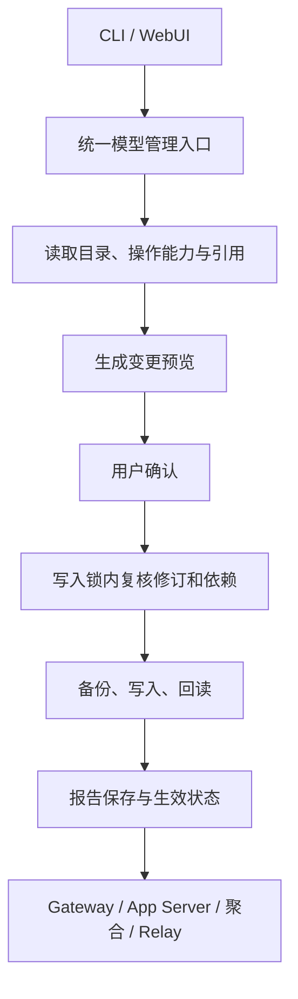

# 第三方模型统一管理设计

状态：设计提案，尚未实施。本文不新增可用命令、API 或配置字段。

审查日期：2026-10-16；源码基线：`2592c9f1d100d9ab973afc4536bdf0ba5e99b0a1`。
本文基于源码关联审查；不把静态推断描述为运行验收。现行行为以
[提供商接入指南](provider-integration-guide.md)、[模型转发](provider-api-relay-development.md)
和各提供商使用文档为准。

## 目标与范围

统一第三方模型的接入、导入、更新、编辑、默认选择、移除与恢复，使 CLI 和 WebUI
共用管理规则，目录展示、聚合路由和实际出站消费一致的有效模型集合。
覆盖自定义 Responses/Chat 接入、使用官方目录的第三方兼容接入、DeepSeek、CLP、CCG、OCG
及其 Relay 使用范围。官方 OpenAI 登录态接入不在本次改造范围内。

不合并账户凭据，不修改会话历史，不增加自动模型替换，不把目录导入当作能力探测，
不引入通用插件框架。统一管理不意味着不同来源都允许相同编辑操作。

## 现状与关联证据

| 链路 | 已实现行为 | 统一管理缺口 |
| --- | --- | --- |
| 自定义目录 | WebUI 编辑提供商可移除模型；目录保存定义与编译结果，默认模型必须存在，至少保留一个模型 | 模型操作与连接配置耦合，缺少独立模型管理入口 |
| CCG、OCG | CLI 可编辑共享启用目录，保护全部账户默认模型，保存前校验并备份 | WebUI 未提供对应目录管理流程 |
| CLP Codex | CLI 有“选择启用模型／更新共享目录”，保护全部账户默认模型 | 本地选择与联网更新绑定；缺少统一 WebUI 入口 |
| DeepSeek | 账户共用模型目录，目录还提供上下文模板 | 缺少统一移除入口；调用资格与模板来源需区分 |
| 使用官方目录的第三方接入 | 读取共享官方目录并校验默认模型 | 没有独立本地选择，不能通过裁剪共享源文件实现单接入移除 |
| CLP Relay | 独立下载 Cline 目录，复用账户凭据，模型列表只读展示 | 与 Codex 目录独立，尚无本地模型移除策略 |

主要证据与责任位置：

- [自定义保存](../scripts/custom-primary-provider-management.mjs)与
  [目录格式](../runtime/model-provider-responses-catalog.mjs)：定义、默认值、目录修订、备份和 pending 恢复。
- [共享目录编辑](../scripts/managed-provider-model-management.mjs)与
  [启用选择校验](../scripts/provider-model-selection.mjs)：CCG/OCG 目录直接表达启用集合，不能移除默认模型。
- [CLP CLI](../scripts/cline-pass-setup.mjs)与
  [CLP 账户和目录管理](../scripts/cline-pass-account-management.mjs)：共享选择、候选投影、联网刷新与账户默认保护。
- [管理路由](../scripts/webui-management-provider-route.mjs)与
  [WebUI 确认控制器](../webui/src/hooks/use-management-confirmed-mutation.ts)：预览、会话绑定确认、修订与回读。
- [出站目录复核](../runtime/provider-model-guard.mjs)与
  [App Server 组合](../runtime/app-server-service-runtime.mjs)：CLP、CCG、OCG、自定义目录请求前校验；DeepSeek 未接入同一托管名单条件。
- [聚合目录](../runtime/aggregate-model-provider.mjs)：从提供商材料派生，不应成为独立编辑源。
- [Relay 材料](../runtime/model-provider-relay-material.mjs)：CLP Relay 使用独立目录；其他接入按各自目录读取。
- [Relay 发布](../runtime/model-relay-service.mjs)与
  [准入撤销](../src/model-relay/admission.ts)：材料修订变化会取消该提供商旧租约，不能承诺只影响被删模型。
- [模型选择服务](../src/application/model-selection-service.ts)：失效的保存选择报错，不自动替换。
- [上下文跟随](../runtime/responses-context-sync.mjs)与
  [计划任务合同](../src/scheduled-tasks/types.ts)：模型还可被模板和持久任务引用。

## 对象与身份

| 对象 | 职责 | 身份与边界 |
| --- | --- | --- |
| 提供商接入 | 地址、协议、接入模式 | 提供商注册身份，不以显示名识别 |
| 账户 | 凭据、默认账户、运行实例 | 如 `clp-main`；模型操作不删除 Key |
| 模型目录 | 来源、模型定义、共享范围 | 服务端解析的目录标识，不接受客户端文件路径 |
| 模型使用设置 | 本地可用性、默认值、允许编辑的参数 | 明确关联目录与使用范围 |

编辑目标为“目录标识 + 精确模型 ID”；调用目标为“提供商实例 + 精确模型 ID”，
由注册关系解析所属目录。显示分组、别名、Relay 公共 ID 和聚合 slug 不能代替源模型身份。
Relay 公共 ID 的规范映射沿用现有实现，不通过字符串猜测反向恢复上游 ID。

共享目录操作必须展示全部受影响账户。聚合目录只读派生。CLP 的 Codex 与 Relay
作为两个明确范围；其他实际共用目录的接入展示联动范围，不制造虚假的独立开关。

## 统一操作语义

| 操作 | 行为 |
| --- | --- |
| 添加 | 手动填写准确模型 ID 和可支持的能力，校验后创建本地定义 |
| 导入 | 从已支持的来源选择候选模型，预览差异后加入 |
| 更新目录 | 展示新增、变更、失效及本地覆盖冲突，确认后应用 |
| 编辑 | 仅修改该来源允许编辑的字段，保留其他模型及未编辑字段 |
| 设置默认 | 明确作用于哪个提供商或账户，不更换凭据 |
| 移除 | 从明确范围的可用集合移除，保留账户、凭据和历史 |
| 恢复 | 显式重新启用；自定义定义已删除时需要备份或重新添加 |

更新不得自动恢复已移除模型，不自动采用新模型或替换失效默认值。新模型先作为可导入项。
本地移除不联网、不要求重新输入 Key；联网更新独立执行，失败不改变当前可用集合。
来源声明与实际探测结果分开呈现，未探测不能标为已支持。

自定义目录可删除定义并重新编译；共享托管目录可移除启用项。
官方源目录、CLP Relay 源目录和作为模板来源的 DS 定义需要保留来源数据，
用明确的本地选择表达调用资格，不能删除源定义来实现全部场景。
不为已能表达启用集合的目录额外复制一份可写模型清单。

## 用户入口与管理合同

WebUI 分为“提供商接入”“账户与凭据”“模型管理”。模型管理按目录归属组织，
展示精确 ID、来源、使用范围、共享账户、默认引用、可用状态和允许的操作。
提供商和账户删除仍位于各自入口，不能把移除模型解释为移除整个接入。

CLI 与 WebUI 调用同一查询、预览、应用和恢复能力。现有菜单转到统一流程，
清理重复校验与写入实现；最终命令、API 字段和类型名称在实现阶段确定，本文不声明它们已存在。

管理编排保留在现有 scripts 管理边界，runtime 提供来源解析、有效模型投影及文件访问能力；
Application/Core 不依赖管理文件路径，Relay 不读取会话能力。
来源适配只负责当前已支持的目录差异，不引入动态插件注册或新凭据仓库。

预览包含输入摘要、目录修订、受影响账户与范围、模型差异、阻断和提示、备份及恢复方式、
激活要求与请求影响。WebUI 沿用现有认证、Origin、会话绑定确认令牌、过期和防重放合同，
参见[管理接口安全](management-interface-security.md)。确认令牌不是跳过后端校验的许可。

应用时在 Provider 管理锁内重读相关状态，校验源目录、账户默认值及依赖修订。
目录、来源文件、选择记录和必要 Profile 的修订都应纳入，不能只哈希页面可见字段。
提交后回读失败或客户端断开不代表写入未发生，必须暴露结果不确定并引导回读，不自动重试。

## 引用与并发约束

| 引用 | 移除策略 |
| --- | --- |
| 任一受影响账户或 Gateway 显式默认模型 | 阻止移除，先明确修改默认值 |
| 未完成计划任务的明确模型引用 | 阻止移除，先修改或取消任务；不能只检查当前页面 |
| Relay Key 授权 | 第一版要求先移除授权，避免恢复模型时旧授权意外恢复 |
| 上下文模板跟随 | 阻止删除源定义；调用资格可单独移除，或先显式解除跟随 |
| 历史 Thread、指标、转储 | 保留，不作为永久阻断条件，不扫描 Codex 内部会话文件 |
| 已保存会话选择 | 保留，使用时提示重新选择，不静默切换 |
| 显示分组 | 检查其他提供商引用，不按裸模型名全局清理 |
| 最后一个有效模型 | 沿用非空目录约束，阻止移除，提示账户或提供商管理入口 |

依赖检查必须区分确认的引用和不能读取的状态；缺失权限、来源损坏或超出扫描限额不得当作无引用。
通过模块公共接口取得所需最小元数据，不增加历史副本或第二会话索引。

默认设置、任务创建及 Key 授权写入口也需反向校验有效模型，防止删除检查之后写入失效引用。
跨 Provider 文件、Gateway 配置及任务存储的并发协调不能仅靠现有 Provider 文件锁保证；
实现前须确定共同的修订复核或提交协调方案及锁顺序，无法覆盖时拒绝有依赖的变更，
不得声称一次预览提供全局原子性。任务派发和实际出站仍做最终可用性校验。

## 运行时与生效

有效模型投影应同时供列表、默认校验、聚合、请求前检查和相关 Relay 材料消费。
DeepSeek 及新增本地选择范围必须补齐出站保护；HTTP、Responses WS、Chat 桥、固定模式、
切换模式和聚合下游均需核对，不允许旧选择或手填 ID 绕过。

“已保存”“运行时已加载”“需要重启”分别报告。不能推断所有 App Server 会即时刷新目录；
原生 TUI 必须通过它实际使用的实例与出站路径验证。不得为模型保存自动终止共享 App Server。
明确的重启操作沿用服务管理生命周期与授权。

Relay 当前材料变化按提供商撤销旧租约，第一版保留并明确提示这一影响，不宣称只取消被删模型。
新请求是否已被拒绝以运行时加载和出站观察为准，不把文件保存时间当作全系统生效时间。
若后续需要按模型粒度保留其他在途请求，应作为单独生命周期改造审查。

## 数据处理、备份与回滚

1. 保留现有自定义定义及编译目录、托管目录、账户和凭据格式；不批量改写用户数据。
   对不能表达本地选择的来源增加最小的版本化选择记录，具体路径、Schema 和上限在实施前确定。
2. 当前启用集合是初始化依据，不推断历史删除项，不用下载的完整候选集合补全已有配置。
   需要新增记录时提供显式初始化预览；未知版本拒绝读取和写入，不隐式迁移。
3. 用户数据继续放在现有私有配置目录，不能放在程序升级会替换的包目录；
   新记录不包含 Key，不增加数据库中的模型历史副本。
4. 写入前备份实际修改的目录、来源、选择记录与 Profile，记录原修订和目标修订；
   文件权限和路径检查沿用 Unix/Windows 适配，禁止把密钥写入预览或审计内容。
5. 现有多文件快照恢复不等于崩溃原子性。跨文件发布需复用或补齐 pending/恢复记录；
   消费方发现未完成事务拒绝使用相关材料，保留完整恢复依据，不拼接新旧文件继续运行。
6. 回滚先验证当前修订仍属于该事务，禁止覆盖后续用户修改；失败保留恢复记录并报告具体状态。
   降级时先恢复升级前完整配置，或显式将选择物化为旧版支持的目录；不能仅删除新选择文件，
   否则会重新开放已排除模型。无法无损物化时阻止降级并说明缺口。

上述方案不授权自动清理历史备份、凭据或账户。实施存储调整前应补齐确切的数据合同与恢复步骤，
再按当时授权范围执行。

## 实施顺序与文档归属

1. 定义目录身份、支持操作、统一预览及生效状态，补齐来源与调用范围映射。
2. 收敛自定义、CCG、OCG、CLP 现有管理能力，分离本地编辑与联网刷新，保留原格式与保护规则。
3. 补齐引用协调、DeepSeek 模板/调用资格分离、外部共享目录的本地选择及出站复核。
4. CLI 和 WebUI 同时接入，移除被替代的独立写入路径，避免新旧入口规则分叉。
5. 完成聚合、Relay、更新、备份及恢复验证后，再在使用文档中声明支持。

阶段划分用于控制依赖，不表示第二阶段后即完成所有提供商统一。
每阶段公开能力必须与已完成的运行保护匹配，不先暴露无后端保障的删除按钮。
实施时同步提供商接入指南、各提供商文档、WebUI、用户指南、受影响模块 README 和公共类型；
新增文档由根索引登记，不把未实现方案混入当前功能说明。

## 验收与未决事项

实施阶段采用真实操作与异常输入观察，不新增测试文件、测试脚本或变相验证脚本：

- CLI 与 WebUI 对同一目录产生相同预览；默认模型、最后一个模型及不支持操作被拒绝且原文件不变。
- 跨账户同名模型、共享目录、CLP 两种范围、Relay 公共 ID 与聚合 slug 的影响准确。
- 保存、重新打开、进程重启、程序升级和目录更新后仍尊重移除状态；恢复需显式选择。
- 旧会话选择、HTTP、WS、Chat 桥、聚合及 Relay 新请求不能绕过有效模型校验。
- 预览后变更默认、目录、任务或 Key 授权会拒绝过期提交；取消、重复确认、写入后断连可识别结果。
- 模板缺失、更新冲突、目录损坏、写入中断及恢复冲突不会自动替换模型或扩大调用范围。
- 核对 Relay 提供商级撤销、请求资源收尾、Unix 文件权限及 Windows ACL/路径约束。

当前未进行删除或故障恢复实机观察。必须在实施前后解决并提供证据的事项包括：
跨文件与任务存储的并发协调、选择记录的精确 Schema、旧版可支持的降级物化范围、
App Server 列表缓存刷新时机、原生 TUI 消费路径及三平台中断恢复。
静态检查与 CI 仅记录工程状态，不替代这些运行证据。
